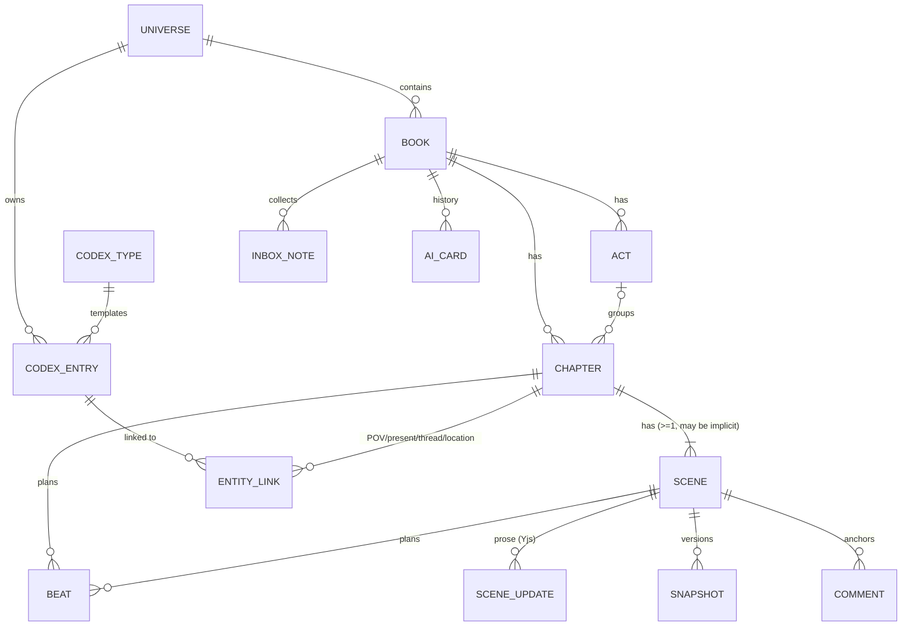
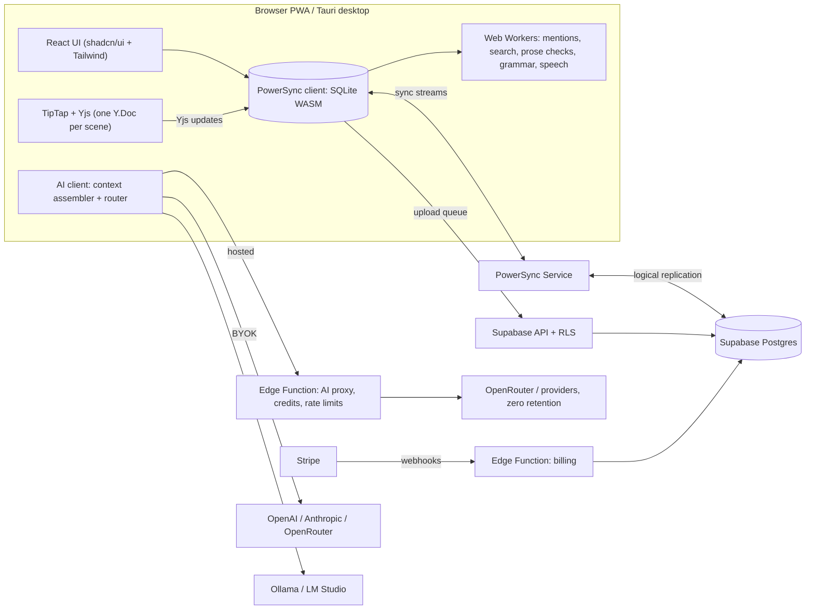

# bookbookbook — Product & Technical Design

> **Status:** Draft v0.1 · **Owner:** @NickPersonalProjects · **Prototype:** `..\prototype\index.html`
> **Name:** bookbookbook, written in lowercase. Run a trademark/domain check before launch (see [Risks](#20-risks-and-mitigations)).

**bookbookbook** is a local-first novel-writing app: a **book planner** (organize what happens in every chapter) joined to
a **chapter-by-chapter writing studio** with focused AI tools. Organization takes cues from NovelCrafter (plan views,
codex). Writing takes cues from Sudowrite (selection tools, AI result cards).

## Contents
1. [Summary](#1-summary)
2. [Product principles](#2-product-principles)
3. [Users and jobs](#3-users-and-jobs)
4. [Information architecture](#4-information-architecture)
5. [Domain model](#5-domain-model)
6. [Planner](#6-planner)
7. [Codex](#7-codex)
8. [Writing studio](#8-writing-studio)
9. [AI system](#9-ai-system)
10. [Speech-to-text](#10-speech-to-text)
11. [Architecture and sync](#11-architecture-and-sync)
12. [Data safety](#12-data-safety)
13. [Import and export](#13-import-and-export)
14. [Accounts, plans and billing](#14-accounts-plans-and-billing)
15. [Visual design](#15-visual-design)
16. [Responsive and mobile](#16-responsive-and-mobile)
17. [Accessibility, i18n, performance](#17-accessibility-i18n-performance)
18. [Security, privacy, legal](#18-security-privacy-legal)
19. [Release plan](#19-release-plan)
20. [Risks and mitigations](#20-risks-and-mitigations)
21. [Open questions](#21-open-questions)
22. [Decision log](#22-decision-log)

---

## 1. Summary

**Pitch:** Plan your novel chapter by chapter, then write each chapter with your plan, your story bible and an AI
assistant beside the page. Everything works offline. Your writing stays yours.

### Decisions at a glance
| Area | Decision |
|---|---|
| Audience | Public product |
| Platform | Local-first web app / PWA. Tauri desktop app in v1.0 |
| Structure | Book › Acts (optional) › Chapters › Scenes (optional) › Beats. Single book now, series-ready data model |
| Planner | Board, Outline, Matrix, Timeline, Corkboard. 11 card fields. Display presets (Compact / Standard / Detailed) |
| Templates | 9 structures (Three-Act … Snowflake wizard, Custom). Scaffold a new book **and** overlay on an existing one |
| Codex | 9 entry types, structured fields + notes, aliases, auto + @-mentions, backlinks, per-entry AI context |
| Writing | Three panes (navigator · page · Plan/Codex/AI). Edit by scene, chapter or whole manuscript |
| AI | "Light+": 11 inline tools + Draft from beats + Chapter feedback. No chat (architecture allows it later) |
| AI output | Cards in a side panel (Insert / Copy / Retry). AI text tinted until edited. "% AI-assisted" stat |
| AI engine | Hosted credits (paid) + bring-your-own-key + local models. Any-model picker. Editable context preview |
| Speech | Dictation everywhere + voice-memo Inbox. On-device by default, opt-in cloud. Audio never kept |
| Stack | React + TypeScript + Vite · TipTap + Yjs · shadcn/ui + Tailwind · Supabase + PowerSync |
| Data | Encrypted at rest. Snapshots, cloud history, zip export, folder auto-backup. E2EE later |
| Business | Free = whole app, local-only, own AI key. Paid "Studio" = sync, cloud history, hosted AI credits |
| Look | "Paper & ink": warm paper, Literata prose, ink-blue accent. Light / Sepia / Dark |
| Launch | Free local **Beta** first. Then paid **v1.0** (accounts, sync, billing, hosted AI, speech, desktop) |

---

## 2. Product principles

1. **The page is the hero.** Chrome recedes while writing. Every panel collapses. Focus mode is one keystroke away.
2. **Plan and prose are one model.** A chapter card and the chapter you write are the same object. Summaries, beats,
   POV and status travel with the text. No copy-paste between a planning tool and a writing tool.
3. **Local-first, always.** The app opens, edits and saves with no network. Sync is a feature, not a requirement.
4. **The writer is the author.** AI never writes into the manuscript on its own. Suggestions arrive as cards and the
   writer chooses what to insert. AI text stays visibly marked until the writer edits it.
5. **Context without ceremony.** The codex is built while writing (mentions, backlinks, quick-create). AI context is
   assembled automatically, and you can always see and edit it before sending.
6. **Honest about privacy and cost.** Every AI request shows where it goes and what it costs. We never train on user
   writing.
7. **Progressive depth.** A new user sees Board + Write + a few AI tools. Matrix, timelines, custom tools and
   templates appear when wanted, not before.

---

## 3. Users and jobs

| Persona | Core jobs | What they need from bookbookbook |
|---|---|---|
| **Plotter** (outlines first) | Break a story into acts and chapters; check structure; track threads | Templates + overlay, Board/Outline, Matrix, Timeline, beats per chapter |
| **Pantser / discovery writer** | Write first, organize later | Fast editor, Summarize chapter → card, auto codex mentions, Brainstorm |
| **Hybrid / series author** | Keep a large cast and world consistent | Codex with aliases and backlinks, AI context from the codex, series-ready model |
| **Busy / mobile writer** | Capture ideas anywhere, write in short sessions | Voice Inbox, phone editing, sprints, daily goals, sync (paid) |
| **AI-cautious writer** | Write without AI, or keep it at arm's length | AI fully optional, BYOK/local only, provenance tint, % AI-assisted |

**Jobs-to-be-done:** "When I sit down to write chapter 7, I want to see what has to happen in it, who's in it and what
they know, so I can write it without rereading the whole book."

---

## 4. Information architecture

```
App
├─ Book switcher (books; later: series/universes)
├─ Plan ─────── Board · Outline · Matrix · Timeline · Corkboard  (+ chapter detail drawer, Structure overlay)
├─ Write ────── Navigator │ Page (scene / chapter / manuscript) │ Right panel: Plan · Codex · AI
├─ Codex ────── Types │ Entries │ Entry page (fields, notes, aliases, appears-in, relationships, progressions)
├─ Inbox ────── Quick notes + voice notes → clean up, turn into beats / summary / codex entry, file to chapter
├─ Command palette (Ctrl/Cmd+K) — navigate, switch views, run any AI tool, toggle modes, settings
└─ Settings ─── AI & models · Writing style · Speech · Appearance · Backups · Account & plan · Privacy
```

**Global elements:** book switcher, today's word goal ring, quick-capture mic, theme switch, command palette, sync /
"Saved locally" status, account chip ("Guest · Local only" before sign-up).

**Navigation rules**
- Plan → **Write ▸** (card, drawer, outline row) opens the Writing studio at that chapter. Write → right-panel **Plan**
  tab edits the same chapter's summary and beats.
- Every codex mention links to its entry (hover preview, click to open in the side panel, Ctrl+click to open the full
  page).
- The last-used Plan view, Display preset and editing unit are remembered **per book, per device**.
- Deep links: `/b/:bookId/plan/:view`, `/b/:bookId/write/:chapterId[/:sceneId]`, `/b/:bookId/codex/:entryId`, `/inbox`.

## 5. Domain model

### Entities


**Series-ready:** codex entries belong to a **universe**, not a book. In v1 every book gets its own universe
automatically and the UI hides the concept. "Series" later means several books sharing one universe.

### Tables (Postgres = source of truth when synced; mirrored in the client's SQLite)
| Table | Key columns | Notes |
|---|---|---|
| `universes` | id, owner_id, name | Hidden in v1 |
| `books` | id, universe_id, owner_id, title, genre, pov, tense, audience, target_words, style_guide, sample_passages (json), template_key, deleted_at | Book-level AI style inputs live here |
| `acts` | id, book_id, title, position | Optional grouping |
| `chapters` | id, book_id, act_id?, position, title, summary, status, pov_entry_id?, word_target, labels (json), template_beat_key?, location_entry_id?, story_time (json), notes | `status` ∈ idea · outlined · drafting · revising · done |
| `scenes` | id, chapter_id, position, title, summary, pov_entry_id?, is_implicit, story_time (json), word_count, ai_word_count | Counts are cached projections of the prose |
| `beats` | id, parent_kind (chapter/scene), parent_id, position, text, done, template_beat_key? | The "what happens" checklist |
| `scene_updates` | id, scene_id, update_b64, created_at, created_by | Append-only Yjs updates (pattern from PowerSync's Yjs + Supabase demo) |
| `snapshots` | id, scene_id, state_b64, word_count, label, kind (auto/manual/compaction), created_at | Version history; compaction base |
| `comments` | id, scene_id, anchor_b64 (Yjs relative positions), body, resolved, created_at | Survive edits around them |
| `codex_types` | id, universe_id, key, name, icon, field_schema (json), builtin | Users can add fields and custom types |
| `codex_entries` | id, universe_id, type_id, name, aliases (json), fields (json), notes (json doc), tags (json), ai_context (always/mentioned/never), color, image_path? | Plot threads and Events are entry types |
| `entity_links` | id, book_id, chapter_id?, scene_id?, entry_id, role (pov/present/thread/location), source (manual/auto) | Drives cards, Matrix, Appears-in |
| `codex_progressions` *(v1.x)* | id, entry_id, from_chapter_id, field_key, value | "As of chapter N, X is true" |
| `codex_relationships` *(v1.x)* | id, from_entry_id, to_entry_id, label, reverse_label | "Jonas — brother of — Mara" |
| `inbox_notes` | id, book_id?, text, source (typed/voice-live/voice-memo), stt_engine, filed_to (json), created_at | Audio is never stored |
| `ai_cards` | id, book_id, scene_id?, tool, model, route (hosted/byok/local), output (json), credits, created_at | User-visible history; "Clear AI history" in settings |
| `custom_tools` | id, owner_id, name, prompt_template, output_mode, default_model | User prompt templates |
| `templates` | id, owner_id? (null = built-in), name, kind (overlay/wizard), beats (json: key, name, pct, description) | 9 built-ins + custom |
| `writing_stats` | id, book_id, date, words_added, words_removed, ai_words_inserted, dictated_words, sprints | Goals, streaks, % AI |
| `credit_ledger` *(server only)* | id, user_id, delta, reason (grant/topup/usage/refund), ref, created_at | Append-only; balance = sum |
| `subscriptions` *(server only)* | user_id, stripe_customer_id, plan, status, period_end | Written by Stripe webhooks |

**Local-only tables (never synced):** `ui_prefs` (views, density, editing unit, panel widths), `provider_keys` (BYOK
keys), `mention_index` (scene_id, entry_id, count — rebuilt locally), `search_index` (full-text index of scene text).

**Prose storage:** one **Y.Doc per scene**. TipTap binds to it through y-prosemirror. Each change appends a binary
update (base64) to `scene_updates`. Plain-text projections (word counts, search index, mention index) are derived on the
client in a worker. Prose is never stored as an HTML blob, so offline edits from two devices merge without conflicts.

**Ordering:** `position` uses fractional indexing (string keys) so concurrent reorders on two devices don't collide.

---

## 6. Planner

### Views
| View | Shows | Interactions |
|---|---|---|
| **Board** | Acts as rows, chapter cards left → right | Drag to reorder or move between acts; click → drawer; "+ Chapter" per act |
| **Outline** | Tree: Act › Chapter › Scene with summaries and beats inline | Keyboard-first: Enter = new item, Tab = fold into the item above, Shift+Tab = split off; inline editing |
| **Matrix** | Rows = characters and plot threads; columns = chapters (grouped by act) | ★ POV · ● present · blank = absent; click to toggle; warns when a thread goes quiet for ≥ 3 chapters |
| **Timeline** | Chapters placed by **in-story** time in POV lanes; codex Events as markers | Toggle story order vs reading order; flashbacks visibly out of sequence |
| **Corkboard** | Index cards (title + summary) | Fast reorder; print/export as cards later |

### Card fields (all 11)
Summary · beats checklist · POV · status · word count / target · labels & colors · plot threads · characters present ·
location · in-story date/time · template beat.

**Display menu (per view):** presets *Compact* (title, status, POV), *Standard* (+ summary, words, threads) and
*Detailed* (all fields), plus per-field toggles. Saved in local `ui_prefs`.

**Chapter detail drawer:** every field, beats (check / add / reorder / dictate), scenes list, notes, linked codex
entries, **Summarize with AI** (writes a proposed summary for you to accept) and **Write ▸**.

**Characters present** combines manual links with auto-detected mentions. Auto links show a subtle "auto" style and
can be confirmed or removed.

### In-story time
`story_time` is a small structure so loose and exact timelines both work:
`{ mode: "relative" | "date", day?: 3, part?: "evening", date?: "1891-10-04T21:00", label?: "12 years earlier", era?: "flashback" }`.
The Timeline sorts by `date` when present, else by `day` + `part`. Items with an `era` go to a compressed segment.

### Templates
Built-ins: Three-Act · 15-beat screenplay structure (Save the Cat!-style) · Hero's Journey (12) · Story Circle (8) ·
Seven-Point · Romance beats (Romancing the Beat-style) · Kishōtenketsu · Snowflake-style wizard · Custom.

- **Scaffold:** "New book from template" creates acts, chapters and starter beats. Each chapter's `template_beat_key`
  and the beat description go into its beats checklist.
- **Overlay:** pick a structure for an existing book. A ribbon above the Board marks where each beat should land
  (% of total target words, or % of chapter count when targets are missing). Mapped beats link to their chapter.
  Unmapped beats are dashed and suggest the chapter that spans that position.
- **Snowflake-style wizard:** step-by-step (one sentence → one paragraph → characters → synopsis → … → chapter list).
  The last step generates the chapter list.
- **Custom templates:** name + beats (name, %, description). Can be shared as a JSON file.
- **Naming:** "Save the Cat!", "Snowflake Method" and "Romancing the Beat" are third-party brands. Use descriptive names
  (as above) unless a license is obtained. Get legal advice.

### Plot threads
A plot thread is a codex entry (type *Plot thread*) with a color and a question it raises. Threads appear as colored
tags on cards, as rows in the Matrix and as filters on every view.

### Built in M1
M1 built the Board, the Outline, the chapter drawer and the Display menu, plus filters, quick create and the Trash.
The Matrix, Timeline, Corkboard and templates follow in M5. Details it settled:
- **Outline keys.** Tab folds an item into the one above: a chapter becomes scenes at the end of the previous chapter,
  and an act's chapters join the previous act. Shift+Tab splits one off: a scene and the scenes after it become a new
  chapter, and on a chapter a new act starts there. Each shows an Undo toast and has a matching command in the item's
  ⋯ menu. Alt+↑/↓ moves acts, scenes within their chapter, and chapters, across acts too.
- **Board.** Cards drag within and between acts (dnd-kit). Alt+arrow keys move the focused card, and screen readers
  hear where it landed.
- **Drawer.** From 1024 px up it docks beside the Board or Outline, which stay usable. Narrower screens get a modal
  sheet, full-screen on phones. `?chapter=` in the URL opens it, so it survives a reload and Back closes it.
- **Filters** by POV, status and thread dim the chapters that don't match, and live in the URL. The Display preset
  and fields are saved per book and per view in `ui_prefs`.
- **Quick create:** "+ Act" and "+ Chapter" in the toolbar, "+" on each act of the Board, Enter in the Outline. The
  drawer's pickers can create a codex entry from what you typed.
- **Trash.** Chapters, scenes and books go to the Trash with an Undo toast and stay for 30 days (§12). The book menu's
  Trash restores them or deletes them for good. Deleting an act can keep its chapters (they join a neighbouring act)
  or send them to the Trash.
- **Plot threads** are codex entries of type `plot_threads`, picked in the drawer like POV, location and characters.
- **Write** lists chapters under their acts. A chapter's Plan link opens its details, and Back returns to writing.
- **Not yet:** characters present are manual links only. Auto-detected mentions, Summarize with AI and dictating
  beats come with M3, M4 and M11.

## 7. Codex

**Types:** Characters · Locations · Objects · Factions · Lore / Magic / Tech · Events (also on the Timeline) · Plot
threads (drive card tags and Matrix rows) · Themes · Custom types.

**Entry page:** name, type, tags, aliases, **AI context** (Always / When mentioned / Never), structured fields from the
type's template (add, remove or reorder fields), rich notes, **Appears in** (chapters + mention counts), and in v1.x
relationships, progressions and an image.

Default character fields: Role · Age · Appearance · Personality · Goal · Wound / fear · **Voice & speech** (used by
Dialogue polish) · Arc.

### Mentions
- **Auto-detection:** names + aliases of all entries are compiled into one matcher (Aho–Corasick or a combined regex)
  in a Web Worker. Rules: whole words only; case-sensitive by default (per-alias override); longest match wins
  ("Jonas Quill" beats "Jonas"). An alias shared by two entries is never auto-linked.
- **@-mentions:** typing `@` opens a codex picker. The result is an inline node that stores the **entry id**, so it
  survives renames and resolves ambiguity.
- **Rendering:** auto-mentions are ProseMirror **decorations**, not stored marks. They are recomputed per changed
  paragraph after a short idle delay, so the prose stays clean and typing never jumps the caret.
- **Hover card:** portrait/initials, type, one-line description, key fields, "Open". Click opens the entry in the
  right panel.
- **Backlinks:** `mention_index` (local) is aggregated per chapter → **Appears in**, Matrix "present" suggestions and
  auto "characters present" links.
- **Quick-create:** select a name → "Add to codex" (pre-filled type guess, alias suggestions).

### Codex and AI
`ai_context` decides inclusion: **Always** (e.g. the protagonist, the magic system), **When mentioned** (default:
included when mentioned in the current scene or the text being sent) and **Never**. In v1.x, progressions are resolved
"as of" the current chapter so the AI doesn't learn spoilers too early.

---

## 8. Writing studio

### Layout
Three panes, each collapsible: **Navigator** (acts › chapters › scenes, with status dots and word counts) ·
**Page** · **Right panel** with tabs **Plan** (summary, beats, notes, metadata for the current chapter/scene) ·
**Codex** (entries mentioned here + pinned) · **AI** (tools, model, context preview, result cards).

### Editing unit
A toolbar toggle: **Scene** · **Chapter** · **Manuscript**.
- Prose is stored per scene. A chapter without scenes has one *implicit* scene, which the UI hides.
- **Chapter** mode stacks the chapter's scene editors with ✦ dividers and foldable scene headers.
- **Manuscript** mode is a virtualized list: editors mount near the viewport. Off-screen scenes render as static
  read-only HTML, so 150k+ word books stay fast.
- Selections can't cross a scene boundary (accepted trade-off). Find & replace and export work across scenes.

### Editor (TipTap / ProseMirror)
| Concern | Extension / approach |
|---|---|
| Content | Paragraph, Text, Bold, Italic, Blockquote, TextAlign (center), custom **SceneBreak** node |
| Typing comfort | Typography (smart quotes, em/en dashes, ellipses), markdown input rules (`*italic*`, `**bold**`, `> `) |
| Collaboration / storage | Collaboration (y-prosemirror) bound to the scene's Y.Doc; Yjs UndoManager |
| Mentions | Mention (`@`) node with codex suggestions; decoration plugin for auto-mentions |
| AI provenance | `aiGenerated` mark `{cardId, model, at}`; a plugin removes it from any range the user edits |
| Comments | `comment` mark with id + Yjs relative-position anchors; thread in the margin |
| Menus | BubbleMenu (selection tools), Suggestion-based slash menu, custom context menu |
| Writing aids | Focus (dims other paragraphs), typewriter-scroll plugin, CharacterCount (words) |
| Checks | Prose-check and grammar decorations from Web Workers (never block typing) |

### Writing aids
- **Goals:** daily words, chapter targets, book target, session goal. Optional streaks (can be turned off).
- **Focus mode** (Ctrl+.): hides chrome and dims all but the current paragraph. **Typewriter scrolling** keeps the
  caret line centered.
- **Snapshots:** automatic (every ~10 minutes of active typing and on leaving a scene) + manual with labels. Compare
  (word diff) and restore. Restoring takes a snapshot first.
- **Comments:** anchored notes and replies, resolve/reopen, dictation in replies.
- **Find & replace:** whole manuscript, results grouped by chapter, regex and match-case options. Replacements run
  as editor transactions so undo and sync work.
- **Read-through mode:** clean, paginated reading view of the compiled manuscript. Comments still allowed.
- **Sprint timer:** 15 / 25 / 45 / custom minutes, words written this sprint, logged to stats.
- **Prose checks (no AI, worker-based):** adverbs, filter words, filler words, repeated words nearby, very long
  sentences, passive-voice heuristics, clichés. Each rule can be toggled.
- **Grammar & spelling:** Harper (Rust → WASM, runs on-device, English) by default. LanguageTool (self-hosted or
  user's account) optional for more languages.
- **Read aloud:** `speechSynthesis` with voice/rate settings and sentence highlighting. Cloud voices maybe later.

### Provenance and stats
- AI-inserted text carries the `aiGenerated` mark → soft tint (toggle in view settings; the data keeps the mark).
- Editing inside a tinted range removes the mark for the edited span only.
- **% AI-assisted** = words still marked ÷ total words, at scene, chapter and book level.
  `writing_stats.ai_words_inserted` keeps the historical count.
- Dictated text is the author's words: never tinted.
- Exports never include tint. A later **AI-usage report** can help with publisher disclosure questions (e.g. KDP's AI
  content question).

### Keyboard
Ctrl+J Continue · Ctrl/Cmd+K palette · Ctrl+Shift+F find & replace · Ctrl+. focus mode · Ctrl+Alt+S snapshot ·
Ctrl+Shift+M dictate · `/` slash menu at the start of an empty line · Esc closes overlays.
All shortcuts can be remapped later.

## 9. AI system

### Tools
| Tool | Input | Output (card) | Insert behavior |
|---|---|---|---|
| **Continue** (Ctrl+J) | Text before the caret | 2 variants, ~150–300 words | At caret |
| **Guided continue** | + an instruction ("Jonas lies about the debt") | 2 variants | At caret |
| **Rewrite** | Selection + preset (Rephrase, More vivid, Show don't tell, More tension, Shorter, Custom…) | 3 variants | Replaces the selection |
| **Describe** | Selection or phrase | Lines grouped by sight, sound, smell, taste, touch, metaphor | Per line, at caret |
| **Expand / Condense** | Selection | 2 variants | Replaces the selection |
| **Brainstorm** | Category (names, twists, what happens next, titles, dialogue…) + prompt | 8–12 ideas | Copy · Add as beat · Add to codex |
| **Summarize chapter** | Chapter prose | 2–3 sentence summary + suggested beats | **Apply to card** |
| **Dialogue polish** | Selected dialogue + speaker's *Voice* field | 2 variants | Replaces the selection |
| **Name generator** | Kind + codex setting/culture | Names that avoid existing names and initials | Create codex entry |
| **Draft from beats** | Scene/chapter beats + summary + context, target length | Long draft → **preview modal** | At caret · Replace scene · Insert as new scene |
| **Chapter feedback** | Chapter + beats + style guide + codex | What works · Pacing · Clarity · Character · Continuity | Comments can be attached to passages |
| **Custom tools** | User template with `{selection} {before} {after} {beats} {summary} {codex} {style}` | Variants, list or long draft | Per output mode |

**Triggers** (all of them): editor toolbar · floating menu on selection · right-click menu · slash commands
(`/continue`, `/describe`…) · shortcuts · command palette.

**Result cards** (AI tab, newest first, like Sudowrite's History): tool, time, model, credits used, streamed body,
**Insert / Copy / Retry / Dismiss**, thumbs up/down (stays on the device; only used to rank variants). Cards persist in
`ai_cards` and can be cleared. Every request can be stopped mid-stream.

### Context assembly
The client builds each prompt from prioritized slots and trims from the bottom when over budget:

| Priority | Slot | Default |
|---|---|---|
| 1 | Tool instructions + output format | Always |
| 2 | Book settings (genre, POV, tense, audience) + style guide | Always |
| 3 | Selection / text before the caret (last ~2–4k tokens) / small window after it | Per tool |
| 4 | Current chapter/scene summary + beats (+ the next beat for Continue) | On |
| 5 | Codex entries set to **Always** | On |
| 6 | Codex entries **mentioned** in the scene or the sent text (resolved "as of" this chapter) | On |
| 7 | Character voices for speakers in the selection | Dialogue polish |
| 8 | Previous chapters' summaries ("story so far") | On, last N |
| 9 | Sample passages (style) | On when set |

- **Context preview** (collapsible in the AI tab): one checkbox per slot, token count per slot, a total meter against
  the model's window, and pin/unpin for codex entries. Edits apply to the next request.
- Token counts use a tokenizer for the selected model family where available, else a characters ÷ 4 estimate
  (shown with "~").
- Prompts are plain templates in the client bundle. They aren't secret, which keeps the context preview honest.

### Model routing
| Route | Path | Who pays | Notes |
|---|---|---|---|
| **Hosted** (Studio plan) | Browser → Supabase Edge Function → OpenRouter (or direct provider contracts) | Credits | Allow-listed models; `data_collection: "deny"` + zero-data-retention routing only |
| **BYOK** | Browser → provider API directly | User's provider account | OpenAI, Anthropic (needs `anthropic-dangerous-direct-browser-access`), OpenRouter. Keys stay on the device |
| **Local** | Browser → `http://localhost:11434/v1` (Ollama) or `:1234/v1` (LM Studio) | Free | OpenAI-compatible API. CORS setup needed (`OLLAMA_ORIGINS`, LM Studio's CORS toggle). Easier in the desktop app |

**Model picker:** grouped Hosted / Your keys / Local, with relative cost ($ · $$ · $$$), context size and an
estimated cost for the current request. Per-tool default models in Settings.

### Credits (hosted AI)
- **Unit:** 1 credit ≈ US$0.01 of upstream model cost at list price *(illustrative — tune before launch)*.
- **Charge** = (input tokens × input price + output tokens × output price) ÷ $0.01, rounded up to 0.1 credit.
  The estimate is shown before sending; the actual cost (from the provider's `usage`) is shown on the card.
- Plans include a monthly grant. Top-up packs are sold with margin. Grants expire monthly; top-ups don't.
- **Server flow:** verify JWT and plan → **reserve** the max cost in Postgres (atomic function on `credit_ledger`) →
  stream → **settle** the actual cost and release the rest. Rate limits per user and per minute, max tokens per tool,
  model allow-list, anomaly alerts.

### Privacy rules
- We never train on user writing, and we only route hosted requests to providers that don't train on or retain it.
- Server logs hold **counts only** (user, model, tokens, latency, status). Never prompts or outputs.
- BYOK and local requests never touch our servers. Each card says where the request went ("OpenRouter → Anthropic").
- Fiction includes violence, sex and crime. Frame prompts as fiction-writing assistance, show provider refusals
  gracefully and let users pick models that suit their genre. The Terms still ban illegal content.

### Later: chat
Not in v1. The context assembler, model routing and cards are tool-agnostic, so a "Chat with your book" panel can be
added later as one more tool with a conversation history.

---

## 10. Speech-to-text

**Where:** notes fields (chapter notes, codex notes, comments) · the global quick-capture mic → **Inbox** · beats and
summaries · the prose editor. Dictated text counts as the author's own words (no AI tint).

### Capture modes
- **Live dictation:** partial results appear in a floating "Listening… [Stop]" pill. Final text is inserted at the
  caret (or the focused field).
- **Voice memo:** record (MediaRecorder) → transcribe → editable text. Audio stays in memory and is **discarded after
  transcription** (or on Discard). Nothing is uploaded unless the cloud engine is chosen.

### Engines (hybrid, on-device first)
| Environment | Default engine | Fallback / opt-in |
|---|---|---|
| Chrome / Chromium 139+ | Web Speech with `processLocally` (language pack via `SpeechRecognition.available()` / `install()`) | In-browser model |
| Safari (macOS / iOS) | Apple's built-in recognizer through Web Speech | Labeled "Apple speech". It may use Apple's servers depending on device and language |
| Edge | In-browser model (Edge's built-in recognition is cloud-based) | Edge/Azure recognition only if cloud is opted into |
| Firefox | In-browser model (no Web Speech recognition without a flag) | Cloud |
| Desktop app (Tauri) | whisper.cpp natively *(option)* | Cloud |
| Any, user opts in | **Cloud · higher accuracy**: hosted (credits) or BYOK transcription API with no-training terms | — |

**In-browser model:** Moonshine (~30–60 MB) for low-latency live dictation; Whisper tiny/base through transformers.js
on WebGPU (~40–100 MB) for memos; whisper.cpp WASM as a slower CPU fallback. Downloaded on first use after consent,
with progress, then cached. Every capture UI shows an engine badge: **On-device** or **Cloud**.

### Voice commands
"new line", "new paragraph", "period", "comma", "question mark", "open quote" / "close quote", "new beat" (in beat
lists), "scratch that" (removes the last utterance), "stop listening". Say "literal …" to type the words instead.
Commands can be turned off in Settings.

### AI helpers (opt-in, any AI route)
- **Clean up:** removes fillers (um, uh, you know), fixes punctuation and casing, keeps the wording. Shown as a diff
  card to accept.
- **Turn into…** beats for a chapter · a chapter summary · a codex entry (extracts fields) · several notes.
- **File to…** a chapter's or codex entry's notes.
- *Open question:* should accepted clean-up of dictated **prose** get a lighter "AI-polished" marker? See
  [Open questions](#21-open-questions).

## 11. Architecture and sync



### Stack
| Layer | Choice |
|---|---|
| App | React + TypeScript + Vite, SPA + PWA (vite-plugin-pwa / Workbox), React Router |
| UI | shadcn/ui (Radix primitives) + Tailwind, lucide icons, dnd-kit (drag & drop), TanStack Virtual |
| Editor | TipTap (ProseMirror) + Yjs, bound by TipTap's Collaboration extension (y-tiptap, its fork of y-prosemirror) |
| Local data & sync | PowerSync Web SDK (SQLite WASM, multi-tab), PowerSync Service (hosted, or self-hosted Open Edition) |
| Backend | Supabase: Auth, Postgres + Row Level Security, Storage, Edge Functions (AI proxy, credits, Stripe webhooks, email backups) |
| UI state | Zustand for ephemeral UI; PowerSync live queries for data |
| Workers | Comlink-wrapped workers for mentions, search, prose checks, Harper, speech models |
| Desktop | Tauri 2 (v1.0): native file backups, OS keychain for API keys, easier local-model access |
| Quality | Vitest, Playwright (incl. offline and multi-tab), axe-core, error reporting with content scrubbing |

### How sync works
1. **Every write is local first:** UI → SQLite. The UI never waits on the network.
2. **Upload:** PowerSync's queue sends row operations to Supabase (our connector's `uploadData`). RLS checks
   ownership. Failed uploads retry; validation errors are surfaced, not silently dropped.
3. **Download:** the PowerSync Service replicates Postgres changes and streams each user only their own books'
   rows (sync rules keyed by `owner_id` / `book_id`).
4. **Conflicts:**
   - Structured fields: last-write-wins **per changed column** (patch uploads).
   - Prose: Yjs CRDT merge, so no conflicts.
   - Ordering: fractional indexes.
   - Deletes: soft (`deleted_at`) with a 30-day trash.
5. **Yjs compaction:** when a scene has more than ~500 updates (or on idle), merge them into a `snapshots` row
   (`kind = compaction`). Then delete only the updates covered by that state vector. Late offline updates still
   merge, because Yjs updates are idempotent and commutative.
6. **Guest → account:** Beta and guest mode use PowerSync **local-only** tables. On sign-up, rows are copied into the
   synced tables in one transaction, then the client connects (PowerSync's local-only → synced pattern).
7. **Multi-tab:** the shared database plus live queries keep tabs consistent. Each open scene's Y.Doc listens for new
   `scene_updates` rows.

### Offline & storage
- The service worker caches the app shell, so the app opens offline after the first visit.
- Call `navigator.storage.persist()` after the first real edit, and show storage status in Settings › Backups.
- **Safari** may delete a site's script-written storage after ~7 days without a visit unless the site is installed to
  the Home Screen / Dock. Beta onboarding must push **Install** and **folder backup** on Safari.
- **Secure origins only.** PowerSync's web SDK needs the Web Locks API, which browsers only offer on `https://` and
  `localhost`. Production is HTTPS anyway, but a dev server opened by LAN address can't start; the startup screen
  says why. Phones reach the dev server through USB port forwarding or Chrome's insecure-origin flag
  ([ime-smoke-test.md](ime-smoke-test.md#setup)).

---

## 12. Data safety

| Layer | What | When |
|---|---|---|
| 1. Local database | SQLite (WASM), persisted | Every keystroke batch |
| 2. Snapshots | Per-scene versions, compare & restore | Auto ~10 min of typing + on leaving a scene; manual |
| 3. Folder auto-backup | Zip of the whole project into a user-chosen folder (File System Access API, Chromium; native in Tauri). Keeps the last N | Daily + on close |
| 4. Export | One-click full `.zip` | Any time |
| 5. Cloud sync + history *(Studio)* | Server copy + 30+ days of snapshots | Continuous |
| 6. Weekly email backup *(v1.x, opt-in)* | Email with an **expiring link** to an encrypted zip, never an attachment | Weekly |
| 7. Trash | Deleted books, chapters, scenes and entries | Restorable for 30 days |

- **Open project format (`.bookbookbook.zip`):** `book.json` (structure, codex, settings), `scenes/<id>.md`
  (Markdown with front matter, human-readable), optional `scenes/<id>.ystate` (lossless Yjs state), `assets/`.
  It must be usable without the app.
- **"Last backup" indicator** in the status bar. If there's no backup or sync for 7 days, show a gentle banner.
- **Encryption:** TLS in transit, provider encryption at rest (Postgres, Storage). **E2EE later**: client-side
  encryption of rows and Yjs updates. Trade-offs: no server-side compaction, search or email backups, and hosted AI
  still needs plaintext per request.

## 13. Import and export

### Import
| Source | Approach | Phase |
|---|---|---|
| DOCX | mammoth (DOCX → HTML) → split on Heading 1/2 or "Chapter N" patterns → **split preview** (rename, merge, set acts) → scenes split on `***`, `* * *`, `#` | Beta |
| Markdown / TXT | Same splitter: `#` / `##` headings or chapter regex | Beta |
| Paste & split | Paste a manuscript, same split preview | Beta |
| Scrivener `.scriv` | Folder package (zip it or use a directory picker): parse the `.scrivx` binder XML + RTF files. Synopsis → summary, notes → notes, label/status → labels/status | v1.x |
| Codex | CSV / Markdown entries | Later |

### Export
| Format | Details | Phase |
|---|---|---|
| DOCX — standard manuscript format | `docx` library. 12 pt Times/Courier, double-spaced, 1" margins, header "Surname / TITLE / page", chapters start a third of the way down, `#` scene breaks, word count on the title page | Beta |
| Markdown · plain text | One file or one per chapter | Beta |
| Full project `.zip` | Open format (see §12) | Beta |
| EPUB 3 | JSZip + XHTML templates, validated with epubcheck in CI | v1.x |
| PDF review copy | pdfmake or a print stylesheet | v1.x |
| Story bible | Codex → PDF / Markdown | v1.x |
| Outline / synopsis | Chapter list with summaries and beats → DOCX / Markdown | v1.x |
| Print-ready interior | Trim sizes, mirrored margins, widows/orphans, drop caps (Paged.js or Typst WASM) | Later |

Export options: choose chapters, include/strip comments, front matter, scene-break style. AI tint is never exported.

---

## 14. Accounts, plans and billing

### Accounts
- **Guest mode:** no account needed. Everything is local. "Guest · Local only" chip. Signing up later migrates data
  (§11).
- **Sign-in:** Supabase Auth with email + password, magic link / one-time code, and Google. (Apple sign-in later if
  native iOS ever happens.)
- **Delete account:** removes cloud data (rows + storage). The local copy stays on the device.

### Plans *(prices illustrative; validate before launch)*
| | **Free** | **Studio** (~$10–15/mo, discounted yearly) |
|---|---|---|
| Plan, write, codex, templates, all aids | ✓ | ✓ |
| AI with your own key or local models | ✓ | ✓ |
| Hosted AI (no key needed) | — | Monthly credit grant + top-ups |
| Sync across devices | — | ✓ |
| Cloud version history (30+ days) | — | ✓ |
| Weekly email backup (v1.x) | — | ✓ |
| Speech: on-device | ✓ | ✓ |
| Speech: cloud (higher accuracy) | Own key | Credits or own key |
| Desktop app | ✓ | ✓ |

**Downgrade:** sync stops. Cloud data stays read-only for 90 days, and local data and export always keep working.

### Billing
- **Stripe Billing:** Checkout + Customer Portal.
- **Webhooks:** `checkout.session.completed`, `customer.subscription.updated/deleted` and `invoice.paid` go to an
  Edge Function. It updates `subscriptions` and grants monthly credits to `credit_ledger`, processing each event
  exactly once (deduped by event id).
- **Stripe Tax** calculates VAT and sales tax, but **you are the seller of record**:
  - Register where required. Non-EU sellers of digital services to EU consumers generally owe VAT from the first sale.
  - US states use economic-nexus thresholds.
  - Alternative: a merchant of record (e.g. Paddle) handles tax for a higher fee.
- **Top-ups:** one-off Checkout payments that add credits. Credits are shown with their dollar value in the usage
  page.

## 15. Visual design

**Direction: "Paper & ink."** Warm paper surfaces, serif prose, quiet sans-serif UI, ink-blue accent. Minimal chrome,
soft layered shadows, nothing loud while writing.

### Tokens
| Token | Light | Sepia | Dark |
|---|---|---|---|
| `--bg` | #F4EFE6 | #EFE4CC | #14161A |
| `--surface` | #FBF8F2 | #F6EDD9 | #1B1E24 |
| `--surface-2` | #F1EBDF | #EDE1C6 | #22262E |
| `--page` | #FFFDF9 | #FAF2E0 | #1E2128 |
| `--ink` | #26241F | #3A2E1F | #E7E2D8 |
| `--ink-2` | #4A463E | #574833 | #CFC8BA |
| `--muted` | #7A7366 | #7C6A50 | #9A9488 |
| `--border` | #E3DACA | #E0D0B0 | #2C313A |
| `--accent` | #2E4A7D | #2E4A7D | #8EA8DC |
| `--accent-soft` | #E4EAF5 | #E6E3DA | rgba(142,168,220,.14) |
| `--ai-tint` | rgba(46,74,125,.09) | rgba(46,74,125,.10) | rgba(142,168,220,.14) |

- **In code** (`src/index.css`): `--muted`, `--border` and `--accent` are named `--ink-muted`, `--line` and
  `--accent-ink`, because shadcn/ui uses those names for its own roles. shadcn's variables are derived from these
  tokens. One token is added: `--danger` (light #B23A2B, sepia #A8402C, dark #E07A6A) for errors and destructive
  actions.
- **Status colors:** idea #9A9488 · outlined #6B7FA6 · drafting #C98A2B · revising #8A63B8 · done #3F7D58. Status
  pills always show text too.
- **Thread palette:** 10 distinguishable hues (teal #2A8C8C, rose #C2557A, amber #C98A2B, …), checked in all themes.
- **Type:**
  - Prose: Literata 19 px / 1.75, ~66 characters per line, book-style first-line indents (none after headings or
    scene breaks).
  - Optional prose fonts: Atkinson Hyperlegible, OpenDyslexic, Courier Prime, iA Writer Quattro (bundle the font
    files and check their licenses).
  - UI: Inter 13–14 px. Headings and wordmark: Literata.
- **Shape & motion:** 4 px spacing grid. Radius 10 px on cards, 8 px on controls. 150–200 ms ease-out transitions.
  All motion respects `prefers-reduced-motion`.
- **Components:**
  - shadcn/ui: Command (palette), Sheet (drawers / bottom sheets), Popover (hover cards), Tabs, Dialog, Toast.
  - Custom: chapter card, beat ribbon, matrix grid, timeline lanes, AI card, dictation pill.

---

## 16. Responsive and mobile

| Width | Layout |
|---|---|
| ≥ 1280 px | Full three-pane studio |
| 1024–1279 px | Right panel becomes an overlay drawer; navigator collapsible |
| 768–1023 px (tablet) | Navigator and right panel are sheets; touch targets ≥ 44 px; drag with long-press |
| < 768 px (phone) | Bottom tab bar (Plan · Write · Codex · Inbox · More); page-only editor; navigator, Plan, Codex and AI open as **bottom sheets**; chapter drawer is full-screen; Board becomes a vertical list grouped by act; Matrix and Timeline scroll horizontally |

**Touch targets** *(built in M1)*
- Sizes follow the pointer, not the width: wherever the main pointer is coarse, at any screen size, every control is
  at least 44 × 44 px. The shared primitives (Button, Toggle, Input, Select, menu and command items, Checkbox, toast
  actions) carry Tailwind `pointer-coarse:` minimums, so screens get them without extra work.
- Small marks keep their look and get a 44 px hit area from an `::after` (checkboxes, a label's remove button).
- The Plan toolbar grows from 48 to 56 px on touch, and the docked drawer's offset and the Outline's scroll margins
  grow with it. On phones its view tabs and its Display and Filter buttons show icons only.
- `e2e/touch.spec.ts` opens the Board, its menus and pickers, the drawer, a toast and the Outline on a phone and a
  tablet, and fails on any control under 44 px.

**Mobile editing specifics**
- On touch devices the OS selection menu competes with ours. Show our tools in a compact bar **docked above the
  keyboard** instead of a floating bubble.
- **Android IME** (Gboard composition, autocorrect, backspace) is ProseMirror's riskiest area. Test on real devices
  from M0. Never recompute decorations inside an active composition (`view.composing`).
  - The M0 spike confirmed the risk. Recomputing mention underlines during a composition left them permanently
    stale, because ProseMirror doesn't redraw decorations under the composing text.
  - The fix: the mention plugin only maps its underlines as text changes, and recomputes them after 150 ms of quiet,
    never mid-composition. An e2e test replays a composition and would catch a regression.
  - Device test bench: `/lab/ime`, with the checklist in [ime-smoke-test.md](ime-smoke-test.md).
- Big mic button in the phone toolbar: dictation is often faster than typing on a phone.

---

## 17. Accessibility, i18n, performance

**Accessibility (target WCAG 2.2 AA)**
- Everything works from the keyboard, with visible focus. Focus never drops to the page body:
  - Links land where a click would. A chapter link opens it with the caret in the prose, a Codex link selects the
    entry's row, and jumping to a screen lands on its tab.
  - Closing a menu or dialog returns focus to the control that opened it.
  - If an action removes the focused control (retrying an AI card that history trimming drops, resetting data),
    focus moves to its replacement.
- Radix gives ARIA semantics for menus, tabs and dialogs.
- Streaming AI output is announced through a throttled polite live region. Dictation state is announced.
- Color is never the only signal:
  - Status pills and thread tags include text.
  - High-contrast mode adds a dotted underline to the AI tint.
- Adjustable prose font, size, line height and width. Dyslexia-friendly fonts.

**i18n:** English UI at launch with externalized strings (i18next or FormatJS). Each book has a **language** that
drives spelling/grammar, speech recognition and prose checks. Harper is English-only, so other languages use
LanguageTool or the browser spellchecker. RTL later.

**Performance budgets**
| Metric | Budget |
|---|---|
| App-shell JS (gzip) | < 250 KB; editor, AI, codex and speech are code-split |
| Keystroke → paint | < 16 ms with a 150k-word book open |
| Open a chapter (local) | < 150 ms |
| Board drag with 100 chapters | 60 fps |
| Manuscript scroll | 60 fps (virtualized editors) |
| Speech models | Downloaded only on demand, cached |

---

## 18. Security, privacy, legal

- **Access control:**
  - Postgres RLS on every table; sync rules mirror RLS.
  - Edge Functions verify the user's JWT.
  - The service-role key never ships to clients.
- **BYOK keys:**
  - Kept in a local-only table, encrypted with a non-extractable WebCrypto key. This protects them at rest, not
    against XSS.
  - Strict CSP, no third-party scripts on the app origin, dependency auditing.
  - OS keychain in the desktop app.
- **Input hardening:** the ProseMirror schema drops unknown markup. Imported HTML (DOCX, paste) is sanitized
  (DOMPurify) before parsing.
- **Telemetry:**
  - Opt-in, cookie-less analytics.
  - Error reports scrub content: no prose, codex text, prompts or outputs ever leave the device.
- **Privacy policy:**
  - What is stored where.
  - Sub-processors: Supabase, PowerSync, OpenRouter and downstream model providers, Stripe, email provider.
  - The no-training promise.
  - Data export and deletion.
- **GDPR:**
  - DPAs with sub-processors and an EU-region project option.
  - Minimum age by region (13 in the US; up to 16 in some EU countries).
- **Terms:**
  - Users own their writing. We get a license only to operate the service.
  - Acceptable-use policy.
  - AI output disclaimer.

## 19. Release plan

| Phase | Price | Contents |
|---|---|---|
| **Beta** | Free | Every local feature: Board, Outline, drawer, Matrix + threads, Timeline, Corkboard, all 9 templates (scaffold, overlay, Snowflake-style wizard), editor core + aids, codex core, all AI tools via BYOK / local, DOCX/MD/paste import, DOCX/MD/zip export, folder backup, phone layout. No server costs |
| **v1.0** | Free + Studio | + accounts (guest migration), sync (PowerSync + Yjs), cloud history, Stripe + hosted AI credits, speech-to-text, Tauri desktop app |
| **v1.x** (fast-follow) | — | Codex progressions, relationships, images · Scrivener import · EPUB / PDF / story bible / outline export · weekly email backup |
| **Later** | — | Print-ready interior · beta-reader links · series (shared universe) · E2EE · co-writing · "Chat with your book" |

### Milestones
| # | Milestone | Size | Highlights |
|---|---|---|---|
| M0 | Foundations + **risk spike** | M | Vite/React/TS, Tailwind/shadcn, theme tokens, PowerSync local-only schema, TipTap + Yjs persisted to SQLite, Android IME smoke test |
| M1 | Structure & Planner I | M | Books, acts, chapters, scenes, beats; Board (dnd-kit), Outline, detail drawer, Display menu |
| M2 | Editor core | L | Scene editors, editing units, formatting, word counts, navigator, snapshots, virtualized manuscript |
| M3 | Codex core | M | Types, fields, aliases, mention worker + decorations, hover cards, @-mentions, Appears-in, codex panel |
| M4 | AI core | L | BYOK + local routing, context assembler + preview, all tools, cards, provenance, custom tools |
| M5 | Planner II | L | Matrix, Timeline, Corkboard, templates (scaffold + overlay), Snowflake-style wizard |
| M6 | Writing aids | M | Focus, typewriter, sprint, find & replace, comments, prose checks, Harper, read aloud, read-through |
| M7 | Import / export / backups | M | DOCX/MD/paste import with split preview, DOCX (manuscript format)/MD/zip export, folder backup, persistence UX |
| M8 | Mobile, a11y, onboarding → **Beta** | L | Bottom sheets, keyboard-docked tools, device testing, axe audit, sample book, install prompts |
| M9 | Accounts & sync | XL | Supabase Auth, sync rules, guest → account migration, compaction, cloud history, multi-device tests |
| M10 | Hosted AI & billing | L | AI proxy, credit ledger (reserve/settle), Stripe Billing + Tax, usage page, plan gating |
| M11 | Speech-to-text | M | Engine abstraction, Web Speech on-device, in-browser models, cloud opt-in, Inbox, voice commands |
| M12 | Desktop + **v1.0 launch** | M | Tauri app, OS keychain, native backups, legal pages, pricing page, docs |

**Beta exit criteria:**
- No open data-loss bugs.
- Installable PWA.
- Tested on Chrome, Edge, Safari and Firefox (desktop), iOS Safari, and Android Chrome with Gboard and Samsung
  Keyboard.
- A 150k-word sample book meets the performance budgets.
- Keyboard + axe audit passes.
- The project format is versioned, with migrations guaranteed from Beta onward.

**Immediate next steps:**
1. Name clearance for "bookbookbook" (trademark, domain, app stores).
2. The phone keyboard test on real devices with Gboard and Samsung Keyboard
   ([ime-smoke-test.md](ime-smoke-test.md)), left over from M0.
3. M1, Structure & Planner I, is built and tested ([README](../README.md)). Next: M2, Editor core.

---

## 20. Risks and mitigations

| Risk | Impact | Mitigation |
|---|---|---|
| **Scope is very large** for a small team | Slips, half-finished features | Milestone gates; Beta cut list; prototype first; defer v1.x items without guilt |
| **Sync correctness** (PowerSync + Yjs) | Lost or duplicated writing | Follow the official Yjs + Supabase demo pattern; offline/online chaos tests; multi-device e2e; snapshots + backups as a safety net |
| **Yjs update growth** | Slow loads, storage cost | Per-scene docs; compaction into snapshots; GC on |
| **Browser storage eviction** (esp. Safari ~7-day rule) | Data loss in Beta | `persist()`, install prompts, folder backup, export reminders, "last backup" indicator |
| **Mobile IME bugs** in ProseMirror | Broken typing on Android | Test from M0 on real devices (`/lab/ime`, [checklist](ime-smoke-test.md)); no decoration updates during composition; an e2e test replays a composition through the Chrome DevTools Protocol; keep a list of known keyboards |
| **AI cost abuse** | Margin loss | Reserve/settle credits, rate limits, max tokens, model allow-list, anomaly alerts; no hosted AI on Free |
| **Model refusals on mature fiction** | Frustrated writers | Model choice, fiction framing, graceful refusals, local models |
| **Provider privacy terms change** | Broken promise | Zero-retention routing only; review sub-processors quarterly; tell users about changes |
| **BYOK key theft via XSS** | User's provider bill | Strict CSP, no third-party scripts, sanitize imports, keychain in desktop |
| **Trademarks** (app name, template names) | Forced rename | Clearance search before launch; descriptive template names unless licensed |
| **Tax & legal** (VAT/sales tax, GDPR, ToS) | Fines, account issues | Stripe Tax + registrations or a merchant of record; DPAs; privacy policy; export/delete tools |
| **Performance on long books** | Laggy editor | Per-scene editors, virtualization, workers, budgets in CI |
| **Speech API fragmentation** | Inconsistent dictation | Engine abstraction, in-browser model fallback, honest engine badges |
| **Vendor lock-in** (Supabase, PowerSync) | Costs or shutdown risk | Both are self-hostable (Supabase OSS, PowerSync Open Edition); open project format |

---

## 21. Open questions

1. **AI clean-up of dictated prose:** should accepted changes get a lighter "AI-polished" marker?
   *Recommendation:* yes. Use a faint dotted underline, counted as "AI-polished", separate from "AI-generated".
2. **Prices:** Studio price, monthly credit grant and top-up pricing. Do Free users get a small one-time trial grant?
3. **Hosted transcription provider:** must offer no-training / zero-retention terms. Check cost per minute.
4. **Hosted model allow-list** and the default model for each tool.
5. **AI history:** sync `ai_cards` and auto-prune after 90 days? *(recommended)*
6. **Template names:** license the branded methods or keep descriptive names?
7. **Name styling:** always lowercase "bookbookbook"? A short form for the app icon (e.g. "b³" or "bbb")?
8. **Analytics:** which privacy-friendly tool, and which events (never content)?
9. **Hosting:** PowerSync Cloud vs self-hosted at scale; Supabase region(s) and an EU option.

---

## 22. Decision log

| Round | Topic | Decision | Notes |
|---|---|---|---|
| 1 | Vision | Public product · local-first web app/PWA · AI "light+" (no chat) | Architecture keeps chat possible |
| 2 | Structure | Book › Acts › Chapters › Scenes › Beats; series-ready; 9 templates, scaffold + overlay | Branded template names need care |
| 3 | Planner | 5 views, 11 card fields, Display presets, threads as tags + Matrix rows, drawer + Write | Last view remembered per book |
| 4 | Codex | 9 types, fields + notes, aliases, auto + @-mentions, backlinks, per-entry AI context | Progressions/relationships/images → v1.x |
| 5 | Writing UI | Three-pane studio; scene/chapter/manuscript toggle; minimal formatting; full aids | Prose stored per scene |
| 6 | AI tools | 11 tools, every trigger, side cards, tint + % AI, custom tools | Sudowrite-style history |
| 7 | AI engine | Hosted credits + BYOK + local; any model; context preview; strict privacy | OpenRouter with zero-retention routing |
| 8 | Stack | React/TS/Vite, TipTap + Yjs, shadcn/Tailwind, Supabase + PowerSync, Tauri later | Alternative: Dexie Cloud (y-dexie) |
| 9 | Data | Encrypted at rest, 5 backup layers, broad export, DOCX/MD/paste/Scrivener import, no sharing in v1 | E2EE and beta links later |
| 10 | Business | Free local + BYOK; Studio = sync, history, credits; email/magic link/Google; guest mode; Stripe Billing + Tax | Alternative: merchant of record |
| 11 | Look | Paper & ink, ink blue, Light/Sepia/Dark, Literata, all devices incl. phone editing | Name chosen: Chapterhouse |
| 12 | Scope | Free local Beta → paid v1.0 → v1.x → later | Design doc + clickable prototype first |
| 13 | Speech | Notes, Inbox, beats/summaries, prose; hybrid on-device-first engine; live + memo; commands + AI helpers | Ships in v1.0 |
| 14 | Name | **Renamed to "bookbookbook"** | Replaces the working name Chapterhouse, which also sidesteps that name's conflicts (Dune novel title, Chapterhouse Studios) |
| 15 | M1 planner | Outline Tab folds into the item above, Shift+Tab splits off, each with Undo and a ⋯ menu command; drawer docked on wide screens; filters and quick create in M1 | Details in §6, "Built in M1" |
