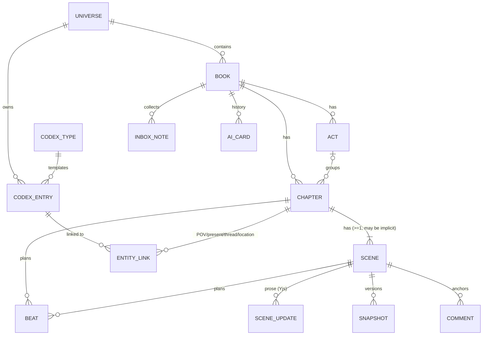
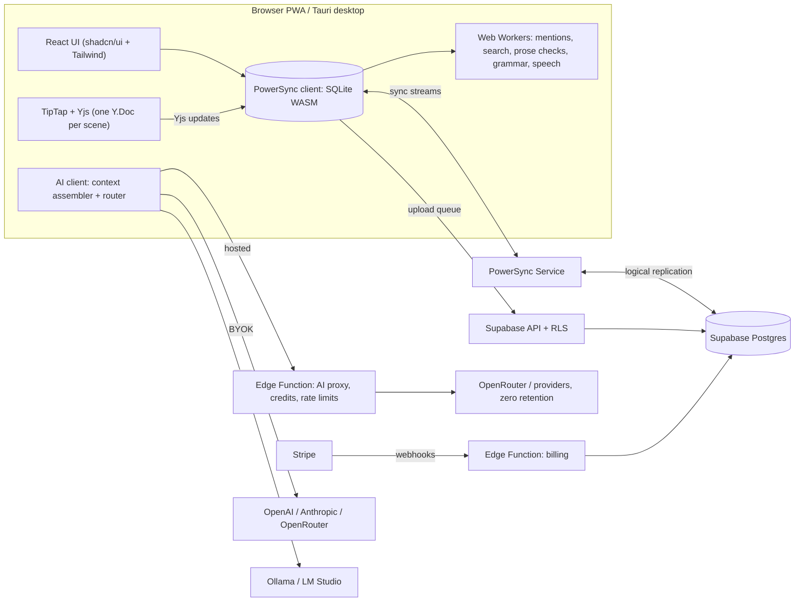

# bookbookbook — Product & Technical Design

> **Status:** Draft v0.1 · **Owner:** @NickPersonalProjects · **Prototype:** `..\prototype\index.html`
> **Name:** bookbookbook, written in lowercase. Run a trademark/domain check before launch (see [Risks](#20-risks-and-mitigations)).

**bookbookbook** is a local-first novel-writing app: a **book planner** (organize what happens in every chapter) joined to
a **chapter-by-chapter writing studio** with focused AI tools. Organization takes cues from NovelCrafter (plan views and
a codex, here called World). Writing takes cues from Sudowrite (selection tools, AI result cards).

## Contents
1. [Summary](#1-summary)
2. [Product principles](#2-product-principles)
3. [Users and jobs](#3-users-and-jobs)
4. [Information architecture](#4-information-architecture)
5. [Domain model](#5-domain-model)
6. [Planner](#6-planner)
7. [World (the codex)](#7-world-the-codex)
8. [Writing studio](#8-writing-studio)
9. [AI system](#9-ai-system)
10. [Speech-to-text](#10-speech-to-text)
11. [Architecture and sync](#11-architecture-and-sync)
12. [Data safety](#12-data-safety)
13. [Import and export](#13-import-and-export)
14. [Accounts, plans and billing](#14-accounts-plans-and-billing)
15. [Visual design](#15-visual-design)
16. [Responsive and mobile](#16-responsive-and-mobile)
17. [Accessibility, i18n, performance](#17-accessibility-i18n-performance)
    - 17a. [Glossary and tours](#17a-glossary-and-tours)
18. [Security, privacy, legal](#18-security-privacy-legal)
19. [Release plan](#19-release-plan)
20. [Risks and mitigations](#20-risks-and-mitigations)
21. [Open questions](#21-open-questions)
22. [Decision log](#22-decision-log)

---

## 1. Summary

**Pitch:** Plan your novel chapter by chapter, then write each chapter with your plan, your story bible and an AI
assistant beside the page. Everything works offline. Your writing stays yours.

### Decisions at a glance
| Area | Decision |
|---|---|
| Audience | Public product |
| Platform | Local-first web app / PWA. Tauri desktop app for Windows (built in M12, §11) |
| Structure | Book › Acts (optional) › Chapters › Scenes (optional) › Beats. Single book now, series-ready data model |
| Planner | Board, Outline, Matrix, Timeline, Corkboard. 11 card fields. Display presets (Compact / Standard / Detailed) |
| Templates | 9 structures (Three-Act … Snowflake wizard, Custom). Scaffold a new book **and** overlay on an existing one |
| World (codex) | 9 entry types, structured fields + notes, aliases, auto + @-mentions, backlinks, per-entry AI context |
| Writing | Three panes (navigator · page · Chapter plan/World/AI). Edit by scene, chapter or whole manuscript |
| AI | "Light+": 11 inline tools + Draft from beats + Chapter feedback. No chat (architecture allows it later) |
| AI output | Cards in a side panel (Insert / Copy / Retry). AI text tinted until edited. "% AI-assisted" stat |
| AI engine | Hosted credits (paid) + bring-your-own-key + local models. Any-model picker. Editable context preview |
| Speech | Dictation everywhere + voice-memo Inbox. On-device by default, opt-in cloud. Audio never kept |
| Stack | React + TypeScript + Vite · TipTap + Yjs · shadcn/ui + Tailwind · Supabase + PowerSync |
| Data | Encrypted at rest. Snapshots, cloud history, zip export, folder auto-backup. E2EE later |
| Business | Free = whole app, local-only, own AI key. Paid "Studio" = sync, cloud history, hosted AI credits |
| Look | "Paper & ink": warm paper, Literata prose, ink-blue accent. Light / Sepia / Dark |
| Launch | Free local **Beta** first. Then paid **v1.0** (accounts, sync, billing, hosted AI, speech, desktop) |

---

## 2. Product principles

1. **The page is the hero.** Chrome recedes while writing. Every panel collapses. Focus mode is one keystroke away.
2. **Plan and prose are one model.** A chapter card and the chapter you write are the same object. Summaries, beats,
   POV and status travel with the text. No copy-paste between a planning tool and a writing tool.
3. **Local-first, always.** The app opens, edits and saves with no network. Sync is a feature, not a requirement.
4. **The writer is the author.** AI never writes into the manuscript on its own. Suggestions arrive as cards and the
   writer chooses what to insert. AI text stays visibly marked until the writer edits it.
5. **Context without ceremony.** The codex is built while writing (mentions, backlinks, quick-create). AI context is
   assembled automatically, and you can always see and edit it before sending.
6. **Honest about privacy and cost.** Every AI request shows where it goes and what it costs. We never train on user
   writing.
7. **Progressive depth.** A new user sees Board + Write + a few AI tools. Matrix, timelines, custom tools and
   templates appear when wanted, not before.

---

## 3. Users and jobs

| Persona | Core jobs | What they need from bookbookbook |
|---|---|---|
| **Plotter** (outlines first) | Break a story into acts and chapters; check structure; track threads | Templates + overlay, Board/Outline, Matrix, Timeline, beats per chapter |
| **Pantser / discovery writer** | Write first, organize later | Fast editor, Summarize chapter → card, auto World mentions, Brainstorm |
| **Hybrid / series author** | Keep a large cast and world consistent | World entries with aliases and backlinks, AI context from World, series-ready model |
| **Busy / mobile writer** | Capture ideas anywhere, write in short sessions | Voice Inbox, phone editing, sprints, daily goals, sync (paid) |
| **AI-cautious writer** | Write without AI, or keep it at arm's length | AI fully optional, BYOK/local only, provenance tint, % AI-assisted |

**Jobs-to-be-done:** "When I sit down to write chapter 7, I want to see what has to happen in it, who's in it and what
they know, so I can write it without rereading the whole book."

---

## 4. Information architecture

```
App
├─ Home ─────── Your books, the last opened first → open one where you left it · New book · Import · Restore · Backups · Trash
├─ Book menu ── All books · New book · Restore · Import · Book settings · Export · Backups · Trash
├─ Plan ─────── Board · Outline · Matrix · Timeline · Corkboard  (+ chapter pop-out, Structure overlay)
├─ Write ────── Navigator │ Page (scene / chapter / manuscript) │ Right panel: Chapter plan · World · AI
├─ World ────── Types │ Entries │ Entry page (fields, notes, aliases, appears-in, relationships, progressions)
├─ Inbox ────── Quick notes + voice notes → clean up, turn into moments / summary / World entry, file to chapter
├─ Help ─────── How to use this (a tour of the page) · Glossary (every term in plain English)
├─ Search ───── The command palette (Ctrl/Cmd+K): chapters, scenes, entries, pages, views, tools, modes, settings
└─ Settings ─── AI & models · Writing style · Speech · Appearance · Backups · Account & plan · Privacy
```

**Global elements:** the bookbookbook logo (home), book menu, How to use this and Glossary, today's word goal ring,
Quick note (an idea for the Inbox, typed or dictated), theme switch, Search (the command palette), sync / "Saved
locally" status, account chip ("Guest · Local only" before sign-up).

**Navigation rules**
- The app opens on the home screen. A book opens on the screen it was last open on (Plan, Write or World, per
  device), or else Write once it has words and Plan before that. The logo and the book menu's **All books** go home.
- Plan → **Write ▸** (card, pop-out, outline row) opens the Writing studio at that chapter. Write → right-panel
  **Chapter plan** edits the same chapter's summary and moments.
- Every World mention links to its entry: resting the mouse on it shows a preview card whose **Details** opens the
  entry in the side panel, and Ctrl+click (⌘-click on a Mac) opens the full page. A plain click places the caret.
- The last-used Plan view, Display preset and editing unit are remembered **per book, per device**.
- Deep links: `/` (home), `/b/:bookId/plan/:view`, `/b/:bookId/write/:chapterId[/:sceneId]`,
  `/b/:bookId/world/:entryId` (older `/codex/` links redirect), `/b/:bookId/inbox`.

### Built after M7: the home screen
- **Your books** lists every book as a card: title, author and genre, words against the word count target, the number
  of chapters and when it was last opened here ("Opened today", "Opened 3 days ago", "Opened 3 Mar", "Not opened
  yet"). They're in order of when each was last opened here, or made if it never was, newest first.
- The whole card is the link, so it's one big target; its title is the link's name. Visits are kept per device in
  `localStorage` (`bbb.bookVisits`), as the last screen and when, and only Plan, Write and World count as visits.
- **New book**, **Import a manuscript**, **Restore from backup**, **Backups** and **Trash** sit above the list. With
  no books the screen says so ("No books yet") and offers the same five. A real install opens on this: only the dev
  server and the end-to-end tests fill an empty library with the sample book (decision 37).
- Inside a book the header shows the book menu, which starts with **All books**; on the home screen it doesn't, since
  there's no book open. Backups from home covers folder backups and the browser's storage, with no "This book".
- An address that isn't a page says so and links to your books.

### Built in M8: Command palette (Search)
- **Search** in the header (a magnifier, named from 1280 px), or **Ctrl+K** (⌘K on a Mac) anywhere, opens the
  command palette, and the shortcut closes it again. The page has Ctrl+K before the browser's own search, but in
  another dialog or a menu it's left to them. The palette notes where focus was, the caret say, for its commands to
  act on and to go back to.
- **It finds** the book's chapters (by title or "Chapter 3"), its scenes with titles, its World entries by name or
  other name, the Plan's views, the other books and the glossary's terms, once something's typed: there can be
  hundreds. Before that it lists the page's actions, the other pages, the book menu's items, help and the themes.
- **It does** what the page's toolbars and menus do. On Write: the views, the chapters list, the side panel's pages,
  focus mode, typewriter scrolling, find and replace, History and a snapshot, goals and sprints, read aloud,
  dictation and its settings, Add to World, scene breaks, block quotes, centering, and every AI tool, the writer's
  own too, with AI settings. On the Plan: a new chapter or act, the structure ribbon, your structures and planning
  step by step. On World: a new entry or type. In a book, Quick note; and everywhere, the book menu's items, the
  page's tour, the glossary and the themes. Shortcuts show beside their commands, except on touch screens. The view
  and theme in use are ticked, and typewriter scrolling and the structure ribbon when they're on.
- **AI tools.** Continue runs at once from the caret, as Ctrl+J does. The others open in the AI panel ready to run,
  as most want a selection or a word on what to do.
- **Ranking.** Every word typed has to match, ignoring case and accents. A label counts for more than its keywords
  (other names, "Chapter 3", old words like "codex"), and a word's start for more than letters inside it. A glossary
  term counts a step lower, as it explains rather than does, so "outline" finds Plan: Outline before the term. The
  section with the best match comes first, and the best match is selected, for Enter.
- **Each page opens things its own way.** A chapter pops out on the Plan, even one chosen as the Plan loads, through
  `?chapter=`; Write goes to its heading; elsewhere it opens on Write. A scene opens on Write with the caret at its
  start. An entry opens in Write's World panel, or else on World. Another book opens on the same page, or from home
  where it was left.
- **Focus.** A command runs once the palette has closed and focus is back where it was, caret and all, so a dialog it
  opens gives focus back there too. One that goes somewhere takes focus with it, to the heading or entry. Escape goes
  back having done nothing. The browser's Back and Forward close it, but the app's own redirects, as from the Plan to
  its last view, don't. Opened again as it fades away, it starts afresh and still goes back where it came from.
- **On phones** it opens at the top of the screen, and on touch screens its rows are 44 px tall.
- The glossary explains **Search**, and the home tour has a step on it, "Find anything".
- `e2e/palette.spec.ts` covers Ctrl+K over the text and back with the caret where it was, opening it again as it
  fades, a chapter and an entry on Write, the Plan's pop-out, views and a scene, an entry on World and Back, focus
  mode, a theme and Book settings, Ctrl+K left to the glossary, an AI tool picked and Continue run, a book and a term
  from home, and a phone; `touch.spec.ts` checks its targets. Unit tests cover the ranking and how a page's commands
  take the place of the app's.

## 5. Domain model

### Entities


**Series-ready:** codex entries belong to a **universe**, not a book. In v1 every book gets its own universe
automatically and the UI hides the concept. "Series" later means several books sharing one universe.

### Tables (Postgres = source of truth when synced; mirrored in the client's SQLite)
| Table | Key columns | Notes |
|---|---|---|
| `universes` | id, owner_id, name | Hidden in v1 |
| `books` | id, universe_id, owner_id, title, genre, pov, tense, audience, target_words, style_guide, sample_passages (json), template_key, deleted_at | Book-level AI style inputs live here |
| `acts` | id, book_id, title, position | Optional grouping |
| `chapters` | id, book_id, act_id?, position, title, summary, status, pov_entry_id?, word_target, labels (json), template_beat_key?, location_entry_id?, story_time (json), notes | `status` ∈ idea · outlined · drafting · revising · done |
| `scenes` | id, chapter_id, position, title, summary, pov_entry_id?, is_implicit, story_time (json), word_count, ai_word_count | Counts are cached projections of the prose |
| `beats` | id, parent_kind (chapter/scene), parent_id, position, text, done, template_beat_key? | The "what happens" checklist |
| `scene_updates` | id, scene_id, update_b64, created_at, created_by | Append-only Yjs updates (pattern from PowerSync's Yjs + Supabase demo) |
| `snapshots` | id, scene_id, state_b64, word_count, label, kind (auto/manual/compaction), created_at | Version history; compaction base |
| `comments` | id, scene_id, anchor_b64 (Yjs relative positions), body, resolved, created_at | Survive edits around them |
| `codex_types` | id, universe_id, key, name, icon, field_schema (json), builtin | Users can add fields and custom types |
| `codex_entries` | id, universe_id, type_id, name, aliases (json), fields (json), notes (json doc), tags (json), ai_context (always/mentioned/never), color, image_path? | Plot threads and Events are entry types |
| `entity_links` | id, book_id, chapter_id?, scene_id?, entry_id, role (pov/present/thread/location), source (manual/auto) | Drives cards, Matrix, Appears-in |
| `codex_progressions` *(v1.x)* | id, entry_id, from_chapter_id, field_key, value | "As of chapter N, X is true" |
| `codex_relationships` *(v1.x)* | id, from_entry_id, to_entry_id, label, reverse_label | "Jonas — brother of — Mara" |
| `inbox_notes` | id, book_id?, text, source (typed/voice-live/voice-memo), stt_engine, filed_to (json), created_at | Audio is never stored. M11 writes `typed` and `voice-live`; `stt_engine` is who heard it (on-device, google, microsoft, apple), `filed_to` where it went (§10) |
| `ai_cards` | id, book_id, scene_id?, tool, model, route (hosted/byok/local), output (json), credits, created_at | User-visible history, the newest 100 per book; Clear all in the AI panel |
| `custom_tools` | id, owner_id, name, prompt_template, output_mode, default_model | User prompt templates |
| `templates` | id, owner_id? (null = built-in), name, kind (overlay/wizard), beats (json: key, name, pct, description) | 9 built-ins + custom |
| `writing_stats` | id, book_id, date, words_added, words_removed, ai_words_inserted, dictated_words, sprints | Goals, streaks, % AI |
| `credit_ledger` *(server only)* | id, user_id, delta, reason (grant/topup/usage/refund), ref, created_at | Append-only; balance = sum |
| `subscriptions` *(server only)* | user_id, stripe_customer_id, plan, status, period_end | Written by Stripe webhooks |

**Local-only tables (never synced):** `ui_prefs` (views, density, editing unit, panel widths), `provider_keys` (BYOK
keys), `mention_index` (scene_id, entry_id, count — rebuilt locally), `search_index` (full-text index of scene text).

**Prose storage:** one **Y.Doc per scene**. TipTap binds to it through y-prosemirror. Each change appends a binary
update (base64) to `scene_updates`. Plain-text projections (word counts, search index, mention index) are derived on the
client in a worker. Prose is never stored as an HTML blob, so offline edits from two devices merge without conflicts.

**Ordering:** `position` uses fractional indexing (string keys) so concurrent reorders on two devices don't collide.

---

## 6. Planner

### Views
| View | Shows | Interactions |
|---|---|---|
| **Board** | Acts as rows, chapter cards left → right | Drag to reorder or move between acts; click → chapter pop-out; "+ Chapter" per act |
| **Outline** | Tree: Act › Chapter › Scene with summaries and beats inline | Keyboard-first: Enter = new item, Tab = fold into the item above, Shift+Tab = split off; inline editing |
| **Matrix** | Rows = characters and plot threads; columns = chapters (grouped by act) | ★ POV · ● present · blank = absent; click to toggle; warns when a thread goes quiet for ≥ 3 chapters |
| **Timeline** | Chapters placed by **in-story** time in POV lanes; codex Events as markers | Toggle story order vs reading order; flashbacks visibly out of sequence |
| **Corkboard** | Index cards (title + summary) | Fast reorder; print/export as cards later |

### Card fields (all 11)
Summary · moments checklist · point of view · status · word count / word count target · labels & colors · story
points · what characters are present · location · in-story date/time · structure moment.

**Plain labels.** The app says what a field is for rather than using the trade's shorthand: **Point of view** (POV),
**Word count target** (target), **What characters are present** (characters present), **Moments** (beats),
**Story points** (plot threads), **Structure moment** (template beat), and **World** (the codex). The old words
stay in the glossary as "also called", so searching for one finds the other (§17a). The data model and the code keep
the old names (`beats`, `pov_entry_id`, `plot_threads`, `codex_entries`).

**Display menu (per view):** presets *Compact* (title, status, point of view), *Standard* (+ summary, words, story
points) and *Detailed* (all fields), plus per-field toggles. Saved in local `ui_prefs`.

**Chapter pop-out:** clicking a chapter on the Board or Outline pops its details out over the Plan: centered on
wider screens, the whole screen on phones. It has every field, moments (check / add / reorder / dictate), the scenes
list, notes, linked World entries, **Summarize with AI** (writes a proposed summary for you to accept) and **Write
this chapter ▸**.

**What characters are present** combines manual links with auto-detected mentions. Auto links show a subtle "auto"
style and can be confirmed or removed.

### In-story time
`story_time` is a small structure so loose and exact timelines both work:
`{ mode: "relative" | "date", day?: 3, part?: "evening", date?: "1891-10-04T21:00", label?: "12 years earlier", era?: "flashback" }`.
The Timeline sorts by `date` when present, else by `day` + `part`. Items with an `era` go to a compressed segment.

### Templates
*Built in M5, with some changes: see "Built in M5" below.*
Built-ins: Three-Act · 15-beat screenplay structure (Save the Cat!-style) · Hero's Journey (12) · Story Circle (8) ·
Seven-Point · Romance beats (Romancing the Beat-style) · Kishōtenketsu · Snowflake-style wizard · Custom.

- **Scaffold:** "New book from template" creates acts, chapters and starter beats. Each chapter's `template_beat_key`
  and the beat description go into its beats checklist.
- **Overlay:** pick a structure for an existing book. A ribbon above the Board marks where each beat should land
  (% of total target words, or % of chapter count when targets are missing). Mapped beats link to their chapter.
  Unmapped beats are dashed and suggest the chapter that spans that position.
- **Snowflake-style wizard:** step-by-step (one sentence → one paragraph → characters → synopsis → … → chapter list).
  The last step generates the chapter list.
- **Custom templates:** name + beats (name, %, description). Can be shared as a JSON file.
- **Naming:** "Save the Cat!", "Snowflake Method" and "Romancing the Beat" are third-party brands. Use descriptive names
  (as above) unless a license is obtained. Get legal advice.

### Story points (plot threads)
A story point is a World entry (type *Plot thread*) with a color and a question it raises. Story points appear as
colored tags on cards, as rows in the Matrix and as filters on every view.

### Built in M1
M1 built the Board, the Outline, the chapter drawer and the Display menu, plus filters, quick create and the Trash.
The Matrix, Timeline, Corkboard and templates followed in M5 (below). Details it settled:
- **Outline keys.** Tab folds an item into the one above: a chapter becomes scenes at the end of the previous chapter,
  and an act's chapters join the previous act. Shift+Tab splits one off: a scene and the scenes after it become a new
  chapter, and on a chapter a new act starts there. Each shows an Undo toast and has a matching command in the item's
  ⋯ menu. Alt+↑/↓ moves acts, scenes within their chapter, and chapters, across acts too.
- **Board.** Cards drag within and between acts (dnd-kit). Alt+arrow keys move the focused card, and screen readers
  hear where it landed.
- **Drawer.** From 1024 px up it docks beside the Board or Outline, which stay usable. Narrower screens get a modal
  sheet, full-screen on phones. `?chapter=` in the URL opens it, so it survives a reload (focus starts on its heading)
  and Back closes it. Word targets show the locale's digit grouping ("3,000") and read it back when typed.
  *Superseded after M7 by the chapter pop-out at every width; see "Built after M7" below.*
- **Filters** by POV, status and thread dim the chapters that don't match, and live in the URL. The Display preset
  and fields are saved per book and per view in `ui_prefs`.
- **Quick create:** "+ Act" and "+ Chapter" in the toolbar, "+" on each act of the Board, Enter in the Outline. The
  drawer's pickers can create a codex entry from what you typed.
- **Trash.** Chapters, scenes and books go to the Trash with an Undo toast and stay for 30 days (§12). The book menu's
  Trash restores them or deletes them for good. Deleting an act can keep its chapters (they join a neighbouring act)
  or send them to the Trash.
- **Plot threads** are codex entries of type `plot_threads`, picked in the drawer like POV, location and characters.
- **Write** lists chapters under their acts. A chapter's Plan link opens its details, and Back returns to writing.
- **Not yet:** characters present are manual links only. Auto-detected mentions, Summarize with AI and dictating
  beats come with M3, M4 and M11. Summarize chapter came in M4, in Write's AI tools (§9, "Built in M4"). M11
  dictates moments by way of the Inbox: a note said with "new moment" between them, filed as moments (§10, "Built in
  M11"). The pop-out has no Dictate of its own yet.

### Built after M7: the chapter pop-out
The docked drawer read as a sidebar, so a chapter's details now pop out over the Plan instead, at every width:
- **Shape.** A modal dialog, centered from 640 px (up to 56rem wide and 54rem tall, the page dimmed behind it) and
  the whole screen on phones. Wide enough pop-outs put the details (status, point of view, word count target,
  location, story time, story points, what characters are present, labels, structure moment) in a column beside the
  summary, moments, scenes and notes.
- **Write this chapter** sits under the title, beside the chapter's words against its word count target, and opens
  Write at the chapter's heading.
- **Previous chapter / Next chapter** in its header step through the book in reading order without closing it.
  The ⋯ menu moves the chapter to the Trash.
- **The address.** `?chapter=` still opens it, so it survives a reload with focus on its heading, and Back closes it.
- **Focus (§17).** Escape, the X or a click outside closes it, and focus returns to the chapter's card or Outline row:
  the one shown last, if Previous or Next moved on.
- **"?" buttons** beside each label open the glossary at that term (§17a).
- `e2e/plan.spec.ts` covers the pop-out's fields, stepping, the address and focus; `e2e/touch.spec.ts` its targets.

### Built in M5
M5 built the Matrix, the Timeline, the Corkboard, story structures and planning step by step. Details it settled:
- **Matrix.** Characters, then story points, down the side in World's order; chapters across the top under their
  acts. A character's cell shows ★ point of view, ● present, or ○ when the chapter's text names them but they aren't
  marked present. Clicking it opens a menu: Not in this chapter, Present, or Point of view, which says whose place it
  takes (they stay present). A story point's cell toggles. A story point missing from 3 or more chapters in a row,
  between two it's in, has *gone quiet*: its cells and name say so, and a note above the grid lists each stretch,
  since readers forget a story point that's away for long. The grid is one Tab stop that keeps its place; arrows,
  Home, End and Ctrl+Home/End move through it. A chapter's heading opens its pop-out, and a name opens its entry.
- **Timeline.** Two orders, remembered per book on the device. *Story order* puts chapters in columns by story time,
  in a lane per point-of-view character (and one for none), with World events, by their When field, in a row above.
  Stretches outside the main story, like a flashback, come first under their own names. Chapters and events with no
  time it can place are listed under "Not placed in time", which says how to place them. *Reading order* keeps the
  book's order and badges each jump: "Back in time (before ch 4)", when a chapter happens before one readers have
  already read, or "Outside the main story". A chapter opens its pop-out, where Story time is set. The view shows
  once its order and events have loaded, so it never switches order or shifts down in front of you.
- **Corkboard.** Index cards, act by act: the title and summary are written right on the card and saved as you
  type. The handle at the top drags the card, or Alt+arrows move it, and a click opens its pop-out. Each card shows
  its status, a Write link, and its words against its target with how many moments it has. "+" on an act adds a
  card with the cursor in its title.
- **Story structures.** Seven built in: Three-act, 15-beat, Hero's journey (12 stages), Story circle (8 steps),
  Seven-point, Romance beats and Kishōtenketsu (four parts), plus the writer's own. A structure's beats are
  *structure moments*, kept apart from a chapter's Moments. The Plan toolbar's **Structure** menu picks one for the
  book (or None), shows or hides the ribbon, and opens Your structures… and Plan step by step…. A chapter's
  Structure moment lists the book's structure's moments with what each is for; a mark from a structure the book no
  longer follows still reads, "(from 15-beat structure)".
- **The ribbon** sits above the acts on the Board and Corkboard. Its bar is the book, each chapter as wide as its
  word count target (an average one when it has none; all equal when none has one), with chapters marked as a moment
  shaded. A pin marks where each moment should land, filled once a chapter is marked as it and dashed till then;
  pins close together stack in up to three tiers. On a touch screen a pin is 28px with a 44px hit area, and pins
  and tiers are spaced 44px apart so the hit areas don't overlap where there's room. Pins are one Tab stop, moved
  through with arrows, Home and End. A pin opens its moment: what it is, how far through the book it falls and in
  which chapter, the chapters marked as it (open or unmark), and "Mark Ch N as this moment" for the chapter there,
  saying which mark that replaces. Each change has Undo. **Hide** keeps it hidden for the book on this device, says
  the Structure menu brings it back, and puts focus there. That setting and the writer's own structures load with
  the plan, so the ribbon never appears late and pushes the cards down as you reach for one.
- **New book, Start with:** one blank chapter (the default), Plan it step by step, or a structure. A structure
  gives a chapter per moment, titled after it and marked as it, in the act its moment falls in, with the book's word
  count target shared out evenly (to the nearest hundred). Their Moments stay empty: the writer's own checklist,
  with the moment's description in the Structure moment picker rather than copied into it. A book's premise and
  synopsis are in Book settings.
- **Your structures.** Shared by all the writer's books. A new one starts from nothing or a copy of any other. The
  editor has its name, its acts (title, and where each starts as a percentage of the book) and its moments (name,
  percentage and what happens), and can make the book follow it. Names stay unique ("My beats 2"). **Save as a
  file** writes JSON (`{ format: "bookbookbook-structure", version: 1, name, acts, beats }`) to share, and **Add
  from a file** reads one back if it's JSON in that format, under 1 MB, with at least one named moment; it keeps at
  most 60 moments and 12 acts, and trims long text. Delete has Undo; a book that followed the structure follows none
  until then. Chapters keep their marks when their structure loses a moment.
- **Plan step by step** (after the Snowflake method) has four steps: the story in a sentence (the premise), in five
  (how it begins, three disasters, how it ends: the synopsis), the main characters (name, part in the story, what
  they want), and the chapters, a chapter per sentence titled after its part and summed up by it, in three acts.
  Adding them saves the premise and synopsis, makes each character a World entry with Role and Goal, and adds the
  chapters, all with one Undo, draft included:
  - **Where they go.** In place of a new book's one untouched chapter, sharing out its word count target; otherwise
    after the book's chapters in new acts, or at the end when it has no acts. There, a checkbox can leave the
    chapters out. Acts left empty aren't added.
  - **The draft** is kept per book on the device as you go, so closing and opening it again returns to the same
    step. Adding clears it.
  - **A synopsis already written** is replaced only after the five-sentence step says so, and the toast says it was.
- **A book's word count target**, in New book and Book settings, accepts "80,000" or "80000" and tidies up as you
  leave the field; anything else says what to type, beside the field.
- **Undo toasts work over dialogs** (§17), so deleting a structure or a moment in the pop-out can be undone in place.
- **Tours** show only the Plan steps a view has (§17a).
- `e2e/plan-views.spec.ts` covers the Matrix, Timeline and Corkboard, the ribbon and Structure menu, a new book from
  a structure, planning step by step (a new book and one with chapters), and Your structures with its files, Undo
  and focus. Unit tests cover the Matrix's marks and quiet stretches, both Timeline orders and their jumps, placing
  moments and stacking pins, scaffolds, structure files, saving structures and the step-by-step plan, with Undo.

## 7. World (the codex)

In the app this is **World**: the people, places, things and story points a book is built from. It was called the
Codex until after M7, but "codex" is jargon a new writer wouldn't know (§22). The screen, its tab, Write's side-panel
page and every button now say World ("Open in World", "Search your world", the "Entry type" menu). The data model,
the code and the older notes below still say codex (`codex_entries`, `src/features/codex/`), and `/b/:bookId/codex/…`
links redirect to `/world/…`.

**Types:** Characters · Locations · Objects · Factions · Lore / Magic / Tech · Events (also on the Timeline) · Plot
threads (drive card tags and Matrix rows) · Themes · Custom types.

**Entry page:** name, type, tags, aliases, **AI context** (Always / When mentioned / Never), structured fields from the
type's template (add, remove or reorder fields), rich notes, **Appears in** (chapters + mention counts), and in v1.x
relationships, progressions and an image.

Default character fields: Role · Age · Appearance · Personality · Goal · Wound / fear · **Voice & speech** (used by
Dialogue polish) · Arc.

### Mentions
- **Auto-detection:** names + aliases of all entries are compiled into one matcher (Aho–Corasick or a combined regex)
  in a Web Worker. Rules: whole words only; case-sensitive by default (per-alias override); longest match wins
  ("Jonas Quill" beats "Jonas"). An alias shared by two entries is never auto-linked.
- **@-mentions:** typing `@` opens a codex picker. The result is an inline node that stores the **entry id**, so it
  survives renames and resolves ambiguity.
- **Rendering:** auto-mentions are ProseMirror **decorations**, not stored marks. They are recomputed per changed
  paragraph after a short idle delay, so the prose stays clean and typing never jumps the caret.
- **Hover card:** portrait/initials, type, key fields (or the notes), "Open in World", and "Details", which opens the
  entry in the right panel.
- **Backlinks:** `mention_index` (local) is aggregated per chapter → **Appears in**, Matrix "present" suggestions and
  auto "characters present" links.
- **Quick-create:** select a name → "Add to World" (pre-filled type guess, alias suggestions).

### World and AI
`ai_context` decides inclusion: **Always** (e.g. the protagonist, the magic system), **When mentioned** (default:
included when mentioned in the current scene or the text being sent) and **Never**. In v1.x, progressions are resolved
"as of" the current chapter so the AI doesn't learn spoilers too early.

### Built in M3
*Written before the rename: the Codex screen is now World, the Codex panel is Write's World page, and "Open in
Codex" reads "Open in World".*

M3 built the Codex screen (types, the entry list, and entry pages with Appears in), hover cards for the names the text
underlines, and a Codex page in Write's side panel. Details it settled:
- **Layouts.** From 1024 px the types, the list and the entry sit side by side. From 768 px the list and the entry
  do, with a "Codex type" menu above the list. Phones show the list or an entry, which links back to the list. Each
  book remembers, per device, the type the list showed and the entry open last, and wide screens reopen that entry.
- **Arrivals (§17).** A link to an entry focuses its row in the list, or the entry's heading on phones. The phone's
  link back lands on the row.
- **Search** looks through every type: names, aliases, tags, fields and notes. A tag filter narrows it, screen
  readers hear how many entries were found, and "No entries match." offers Clear search.
- **Entries.** "New character" (or location, and so on) adds an entry and focuses its name. Tags and aliases are
  chips, and tags suggest the ones already in use. A name or alias that another entry also has gets a warning that
  links to it, since a shared name is never underlined. A color from the palette tints the entry's initials.
- **Details** are the type's fields, then the entry's own. "Add to every character" adds a field to the type.
  Removing a type's field takes it off the type and that entry; other entries that filled it in keep it as their
  own, and the toast says how many. Field names ignore case, so "Owner" and "owner" are one field.
- **Appears in** lists, in reading order, the chapters that mention the entry or link it in the plan, with its roles
  there (POV, Location, Thread, Present) and its mentions. A chapter opens in Write at its heading. Events, plot
  threads and themes aren't looked for in the prose, since their names are often ordinary words.
- **Mentions stay on the main thread.** One combined regex finds 6,250 mentions of 300 entries in a 150k-word book in
  about 4 ms on a desktop, so the planned worker isn't needed.
- **Trash and Undo.** A trashed entry gives its place to the next one in the list. Its Undo toast, like those for
  removing a field or deleting a type, puts focus back on what it restores. The book menu's Trash keeps entries for
  30 days.
- **Custom types** can be added, renamed and, once empty, deleted, with Undo. The form refuses a name another type
  has.
- **Hover cards.** Resting the mouse on an underlined name for 350 ms opens its card: initials, type, up to three
  filled-in fields (or the notes), "Open in Codex" and "Details". The card swaps at once for the next name, stays
  while the pointer is on it, and closes 200 ms after the pointer leaves both. A key, a scroll or Escape closes it, and
  no card opens for half a second after a key, so a pointer resting on the text stays quiet while the writer types.
  The card never takes focus: "Details" opens the entry in the panel, and the caret stays where it was.
- **Clicks.** A plain click on a name places the caret, like anywhere else in the text; §4 first had it open the
  panel, which would make names hard to edit. Ctrl+click (⌘-click on a Mac) opens the entry on the Codex screen.
  Cards are for mice: keyboards and touch screens reach the same entries through the panel.
- **The Codex panel.** Write's side panel has two pages, Chapter plan and Codex, each a toolbar button that opens or
  closes it (items in the ⋯ menu on phones). One shows at a time, and wide screens remember which. **In this
  chapter** comes first: the POV, the location, then the entries the text names, most mentioned first, and last the
  plan's links the text doesn't name. Each row says how the entry is there ("POV · Present · 4 mentions"), and the
  counts follow the text a second after typing stops. Below come every entry by type and a search like the Codex
  screen's.
- **Entries in the panel.** A row opens the entry's page in the panel: tags, aliases, its part in the chapter, its
  filled-in fields and notes. Back returns to the list where it was left, and "Open in Codex" goes to the full page.
  The panel only reads: entries are edited on the Codex screen.
- **Focus (§17).** Opening the panel from the toolbar focuses its heading, and an entry's heading takes focus when it
  opens. Back lands on the entry's row: the one it was opened from, or after "Details" the one in view. Closing
  returns to the button that opened the panel, or to the text if "Details" did.
- **Touch:** every control is at least 44 px on touch screens.
- **Not yet:** @-mentions, per-alias case options, pinning entries to the panel, and a shortcut for the entry at the
  caret. @-mentions would put a node in the stored prose, which export, word counts, History's compare and backups
  all read, and they need testing with Android keyboards. Quick-create from a selection came in M6 as Add to World
  (§8, "Built in M6").

---

## 8. Writing studio

### Layout
Three panes, each collapsible: **Navigator** (acts › chapters › scenes, with status dots and word counts) ·
**Page** · **Right panel** with pages, each opened from the toolbar: **Chapter plan** (summary, moments, notes,
details for the current chapter/scene) · **World** (entries mentioned here + pinned) · **AI** (tools, model, context
preview, result cards).

### Editing unit
A toolbar toggle: **Scene** · **Chapter** · **Manuscript**.
- Prose is stored per scene. A chapter without scenes has one *implicit* scene, which the UI hides.
- **Chapter** mode stacks the chapter's scene editors with ⁂ dividers and scene headers.
- **Manuscript** mode is a virtualized list: editors mount near the viewport. Off-screen scenes keep their space but
  render nothing, so 150k+ word books stay fast.
- Selections can't cross a scene boundary (accepted trade-off). Find & replace and export work across scenes.

### Editor (TipTap / ProseMirror)
| Concern | Extension / approach |
|---|---|
| Content | Paragraph, Text, Bold, Italic, Blockquote, TextAlign (center), custom **SceneBreak** node |
| Typing comfort | Typography (smart quotes, em/en dashes, ellipses), markdown input rules (`*italic*`, `**bold**`, `> `) |
| Collaboration / storage | Collaboration (y-prosemirror) bound to the scene's Y.Doc; Yjs UndoManager |
| Mentions | Mention (`@`) node with codex suggestions; decoration plugin for auto-mentions |
| AI provenance | `aiGenerated` mark `{card, model}`; a plugin removes it from any text the writer types into it |
| Comments | `comment` mark with id + Yjs relative-position anchors; thread in the margin |
| Menus | BubbleMenu (selection tools), Suggestion-based slash menu, custom context menu |
| Writing aids | Focus (dims other paragraphs), typewriter-scroll plugin, CharacterCount (words) |
| Checks | Prose-check and grammar decorations from Web Workers (never block typing) |

### Writing aids
*M6 built goals and streaks, focus mode, typewriter scrolling, sprints, find & replace and read aloud, with some
changes; comments, read-through, prose checks, grammar and a session goal are still to come. See "Built in M6" below.*
- **Goals:** daily words, chapter targets, book target, session goal. Optional streaks (can be turned off).
- **Focus mode** (Ctrl+.): hides chrome and dims all but the current paragraph. **Typewriter scrolling** keeps the
  caret line centered.
- **Snapshots:** automatic (every ~10 minutes of active typing and on leaving a scene) + manual with labels. Compare
  (word diff) and restore. Restoring takes a snapshot first.
- **Comments:** anchored notes and replies, resolve/reopen, dictation in replies.
- **Find & replace:** whole manuscript, results grouped by chapter, regex and match-case options. Replacements run
  as editor transactions so undo and sync work.
- **Read-through mode:** clean, paginated reading view of the compiled manuscript. Comments still allowed.
- **Sprint timer:** 15 / 25 / 45 / custom minutes, words written this sprint, logged to stats.
- **Prose checks (no AI, worker-based):** adverbs, filter words, filler words, repeated words nearby, very long
  sentences, passive-voice heuristics, clichés. Each rule can be toggled.
- **Grammar & spelling:** Harper (Rust → WASM, runs on-device, English) by default. LanguageTool (self-hosted or
  user's account) optional for more languages.
- **Read aloud:** `speechSynthesis` with voice/rate settings and sentence highlighting. Cloud voices maybe later.

### Provenance and stats
*Built in M4, all but the AI-usage report (§9, "Built in M4").*
- AI-inserted text carries the `aiGenerated` mark → soft tint (toggle in AI settings; the data keeps the mark).
- Editing inside a tinted range removes the mark for the edited span only.
- **% AI-assisted** = words still marked ÷ total words, kept per scene and shown for the chapter and the book.
  `writing_stats.ai_words_inserted` keeps the historical count, and Today counts only the writer's own words.
- Dictated text is the author's words: never tinted.
- Exports never include tint. A later **AI-usage report** can help with publisher disclosure questions (e.g. KDP's AI
  content question).

### Keyboard
Ctrl+J Continue · Ctrl/Cmd+K Search (the palette) · Ctrl+Shift+F find & replace · Ctrl+. focus mode · Ctrl+Alt+S
snapshot · Ctrl+Shift+M dictate · `/` slash menu at the start of an empty line · Esc closes overlays.
All shortcuts can be remapped later. Built so far: Ctrl+J, Ctrl/Cmd+K (M8), Ctrl+Shift+F, Ctrl+., Ctrl+Alt+S,
Ctrl+Shift+M (M11), the formatting keys and Esc. Ctrl+Shift+M is also Chrome's and Edge's profile menu, and Ctrl+K
the browsers' web search, but the page has them first.

### Built in M2
M2 built the Write screen: the three views, the navigator, formatting, word counts, History and the chapter plan
beside the text. Focus mode, find & replace and the other writing aids came in M6 (below). Details it settled:
- **Views.** A segmented control switches Scene, Chapter and Manuscript, remembered per book. The URL names the
  chapter, and the scene in the Scene view, so a reload or a link lands in the same place. A switch opens the new view
  at the scene being written or read. The Scene view pages through the book's scenes in reading order, across
  chapters.
- **Manuscript:** the whole book on one page, under its acts. A scene gets its editor within 1000 px of the window and
  loses it beyond 3000 px, never while it has focus. Without its editor it's a blank space of the height it last had,
  or one guessed from its word count, so the browser's find can't see it; find & replace (M6) searches the scenes'
  text itself instead. The URL follows the chapter being read.
- **Arrivals hold still.** After a jump, the scenes around the target get their editors and seldom take the height
  guessed for them. The page keeps the target in place until the layout has been still for 1 s (5 s at most) or the
  writer scrolls, taps, clicks or types, and the URL waits for it. Chrome's scroll anchoring can't be relied on for
  this (it may anchor to a placeholder that's about to go), and Safari has none.
- **Scenes** are divided by ⁂. A scene's header holds its title and a ⋯ menu: Move up, Move down, History… and Move
  to Trash, with Undo. A chapter is one implicit scene, without a header, until the writer adds another: the text so
  far becomes scene 1. A chapter gets its implicit scene when first opened, or as the Manuscript nears it. Scene
  controls name their chapter ("Title of scene 2 in chapter 3"), since the Manuscript shows many.
- **Formatting:** bold (Ctrl+B), italic (Ctrl+I), block quote (Ctrl+Shift+B), centred lines (Ctrl+Shift+E, and
  Ctrl+Shift+L back) and scene breaks; ⌘ on a Mac. Typography turns quotes, dashes and ellipses typographic, and
  nothing else. With no editor focused, the toolbar acts on the scene filling most of the window.
- **Counts** are saved a second after typing pauses: scenes, chapters against their targets, and the book against its
  target in the navigator. **Today** in the toolbar is the net words written in the book today; its tooltip splits
  them into added and removed. `writing_stats` rows are per device and local day, so sync will add devices up rather
  than merge them.
- **History.** A scene saves an automatic version of its text as it was before the first edit of a sitting, every 10
  minutes while it's edited, and when it's left. An unchanged one is skipped, and the newest 50 are kept. Snapshots
  (Ctrl+Alt+S, or the History dialog) can be named and are kept until the scene is deleted for good. The dialog opens
  on the newest version, so no phone keyboard pops up, and shows paragraph by paragraph what restoring it would add
  and remove. Restore first saves the text it replaces as "Before restoring", and the toast's Undo puts that back.
  Restored words count toward Today.
- **Chapter plan.** The chapter's details from the Plan dock beside the text from 1280 px, their state remembered
  per device, and are a sheet below that. Trashing the chapter from them closes them.
- **Phone:** the toolbar has a chapter picker, bold and italic, and a ⋯ menu with the views and the other tools.
- **Not yet:** folding scenes. Known issue: resizing the window can leave the URL on the previous chapter until the
  next scroll.

### Built in M6
M6 built the writing aids: focus mode, typewriter scrolling, daily goals and streaks, sprints, Add to World, read
aloud, and find and replace across the book. Details it settled:
- **Toolbar.** The wide toolbar gained Today's goals, a Focus mode button, a ⋯ **More writing tools** menu (Add to
  World…, Read aloud, Goals and sprints…, Typewriter scrolling) and Find, beside History, Chapter plan and World.
  On phones they're all in the ⋯ menu, which ends with today's words added and removed. New controls are 44 px on
  touch screens.
- **Focus mode** (Ctrl+., ⌘. on a Mac). The header, the navigator, the side panel, the phone's tabs and most of the
  toolbar go; a slim bar keeps Today (or a running sprint's clock) and the way out, fading while the writer types.
  Every paragraph but the caret's dims, and the scene titles and buttons with them until hovered or focused. Esc in
  the text, the same keys or the bar's button end it. The caret keeps its place on screen as the chrome comes and
  goes. It lasts while the Write screen is open and isn't remembered.
- **Typewriter scrolling**, a checkbox in the ⋯ menus remembered per device, keeps the caret's line halfway down the
  text's part of the window: below the toolbar, and above a phone's keyboard. It waits for a phone keyboard's
  composition to end, leaves a click or a selection being made where it is, and jumps rather than glides with reduced
  motion.
- **Goals and sprints** hang below the toolbar from Today (on phones, from the ⋯ menu). A **daily goal** is per book
  and counts net words, as Today does, so a day spent cutting can fall short, and that's fair. A ring around Today
  fills toward it, and a toast says when it's met. The **streak** is the days running with the goal met: today joins
  once it's met, until then it runs to yesterday, and past days are held to the goal as it is now. **Show my
  streak** (per device) hides it.
- **Sprints** last 15, 25 or 45 minutes, or the writer's own length up to 240. Starting one puts the caret back in
  the text, and Today becomes its countdown (on phones a clock joins the toolbar). It counts this device's net words
  in the book from its start. One runs at a time, kept in localStorage, so a reload or another tab carries on with
  it, and one that ran out while the app was closed is counted when it next opens. At the end a toast gives its
  words, and `writing_stats.sprints` counts it; one stopped early isn't counted, though its words still count for
  the day. Screen readers hear "12 minutes left" rather than a ticking clock.
- **Add to World** (§7's quick-create). Selecting a name the World doesn't have shows an **Add to World** bubble over
  it, which Tab reaches from the text. A name is up to six words, capitalized, and not a word that opens sentences;
  quotes, punctuation and a possessive are trimmed ("Mara's," → "Mara"). The ⋯ menus open the dialog for any name,
  and it warns of one the World has. The dialog takes the name, the type (the one used last, per device, else
  Characters), the shorter names the text might use ("Jonas" and "Quill" for "Jonas Quill") and notes. The text
  underlines the new entry at once, and the toast's Details opens it. On touch screens the system's selection menu
  keeps its place, so the ⋯ menu was the way in until M8 put Add to World in the bar above the keyboard (§16).
- **Read aloud** (the ⋯ menus) uses the device's voices (`speechSynthesis`), a sentence at a time
  (`Intl.Segmenter`, with a fallback), marking each sentence and keeping it in view above the reading bar. It starts
  at the caret's sentence and goes on through the scenes the view shows (the chapter, or in the Manuscript the
  book), or reads only the selection. The bar has play and pause, the previous and next sentence, stop, speed (0.75×
  to 2×) and voice (the browser's language's), the last two kept per device. Esc or Stop leaves the caret on the
  sentence it reached, ready to fix what was heard; typing stops it too. Without speech in the browser, it isn't
  offered. Focus mode leaves the sentence being read undimmed.
- **Find and replace** (Find in the toolbar, Ctrl+Shift+F) is a page of the side panel, so it's remembered with the
  others, and a sheet over the text on narrow screens, which a result closes to select its match. It searches every
  scene as it's typed, open ones from their live text and the rest as stored, and keeps up with edits a quarter of a
  second after them. Options: **Match case**, **Whole words** and **Pattern** (a regular expression, saying so when
  it has a mistake). Straight and curly quotes, `--` and —, and `...` and … find each other. A match can't cross a
  paragraph or a line break, as it couldn't be replaced as one stretch of text.
  - **The list** groups matches by chapter (and by scene, where the writer made scenes), each with the words around
    it, and says how many there are and which one is current. It lists 1,000 and counts up to 10,000. The editors on
    the page mark every match, the current one apart.
  - **Going to a match.** Enter and Shift+Enter, or the ˄ and ˅ buttons, go round the book from the current match,
    or else from the caret. A match whose scene isn't on the page is brought there first: the Manuscript holds its
    scene in view, and the Chapter and Scene views go to its chapter or scene. Ctrl+Shift+F searches for the words
    selected (one line, up to 200 characters), and Esc goes back to the text at the match.
  - **Replace** goes to the match first, then replaces it as one edit Ctrl+Z undoes. **Replace all** saves a version
    of each scene it changes ("Before replacing “ledger”"), edits the scenes' Yjs text directly, keeping the first
    matched character's formatting, so closed scenes change too, and its toast's Undo puts every scene back for up
    to a minute. A pattern's replacement fills in `$1`, `$<name>`, `$&` and `$$`.
- **Undo and outside changes.** y-tiptap restores a selection with the next change after an undo, so a change from
  outside the editor (Replace all, a version restored, another tab) would move the caret back to before the undone
  edit; UndoSelection drops that selection once the undo is over.
- **Navigation that keeps up.** React Router 8 runs navigations as transitions, which can commit after the writer's
  next key press and pull the page away from it. Switching views and Find's jumps navigate with `flushSync`, so the
  URL, and the page's arrival at it, land before the next key. The Manuscript's following URL stays a transition.
- **Esc in the text** goes through one handler (EscapeKey), since ProseMirror keeps Esc from the page: it stops
  reading aloud first, then leaves focus mode.
- **Not yet:** comments, read-through mode, prose checks, grammar and spelling (Harper), @-mentions, a session goal
  and a history of sprints. Comments and @-mentions put new nodes or marks in the stored prose, which export, word
  counts, History's compare and backups all read; Harper needs a WASM worker.
- `e2e/writing-aids.spec.ts` covers Add to World (the bubble, the menus, names the World has, phones), read aloud
  (from the caret or a selection, speed and voice, the view's end, phones), focus mode and typewriter scrolling,
  goals and sprints (through a reload, phones) and find and replace (the whole book, Replace, Replace all with its
  versions and Undo, patterns, the shortcut, the panel button, narrow screens, and keys pressed quickly).
  `e2e/touch.spec.ts` holds every writing aid's controls to 44 px on a phone and a tablet. Unit tests cover the find
  engine, its list and highlights, read aloud's sentences and mark, goals and streaks, today's words and Add to
  World's names.

## 9. AI system

### Tools
*M4 built every tool here, with some changes, run from the toolbar's AI tools, the ⋯ menu and Ctrl+J. The other
triggers, thumbs, credits, the draft's preview and feedback as comments are still to come. See "Built in M4" below.*

| Tool | Input | Output (card) | Insert behavior |
|---|---|---|---|
| **Continue** (Ctrl+J) | Text before the caret | 2 variants, ~150–300 words | At caret |
| **Guided continue** | + an instruction ("Jonas lies about the debt") | 2 variants | At caret |
| **Rewrite** | Selection + preset (Rephrase, More vivid, Show don't tell, More tension, Shorter, Custom…) | 3 variants | Replaces the selection |
| **Describe** | Selection or phrase | Lines grouped by sight, sound, smell, taste, touch, metaphor | Per line, at caret |
| **Expand / Condense** | Selection | 2 variants | Replaces the selection |
| **Brainstorm** | Category (names, twists, what happens next, titles, dialogue…) + prompt | 8–12 ideas | Copy · Add as beat · Add to codex |
| **Summarize chapter** | Chapter prose | 2–3 sentence summary + suggested beats | **Apply to card** |
| **Dialogue polish** | Selected dialogue + speaker's *Voice* field | 2 variants | Replaces the selection |
| **Name generator** | Kind + codex setting/culture | Names that avoid existing names and initials | Create codex entry |
| **Draft from beats** | Scene/chapter beats + summary + context, target length | Long draft → **preview modal** | At caret · Replace scene · Insert as new scene |
| **Chapter feedback** | Chapter + beats + style guide + codex | What works · Pacing · Clarity · Character · Continuity | Comments can be attached to passages |
| **Custom tools** | User template with `{selection} {before} {after} {beats} {summary} {codex} {style}` | Variants, list or long draft | Per output mode |

**Triggers** (all of them): editor toolbar · floating menu on selection · right-click menu · slash commands
(`/continue`, `/describe`…) · shortcuts · command palette.

**Result cards** (AI tab, newest first, like Sudowrite's History): tool, time, model, credits used, streamed body,
**Insert / Copy / Retry / Dismiss**, thumbs up/down (stays on the device; only used to rank variants). Cards persist in
`ai_cards` and can be cleared. Every request can be stopped mid-stream.

### Context assembly
The client builds each prompt from prioritized slots and trims from the bottom when over budget:

| Priority | Slot | Default |
|---|---|---|
| 1 | Tool instructions + output format | Always |
| 2 | Book settings (genre, POV, tense, audience) + style guide | Always |
| 3 | Selection / text before the caret (last ~2–4k tokens) / small window after it | Per tool |
| 4 | Current chapter/scene summary + beats (+ the next beat for Continue) | On |
| 5 | World entries set to **Always** | On |
| 6 | World entries **mentioned** in the scene or the sent text (resolved "as of" this chapter) | On |
| 7 | Character voices for speakers in the selection | Dialogue polish |
| 8 | Previous chapters' summaries ("story so far") | On, last N |
| 9 | Sample passages (style) | On when set |

- **Context preview** (collapsible in the AI tab): one checkbox per slot, token count per slot, a total meter against
  the model's window, and pin/unpin for codex entries. Edits apply to the next request.
- Token counts use a tokenizer for the selected model family where available, else a characters ÷ 4 estimate
  (shown with "~").
- Prompts are plain templates in the client bundle. They aren't secret, which keeps the context preview honest.

### Model routing
| Route | Path | Who pays | Notes |
|---|---|---|---|
| **Hosted** (Studio plan) | Browser → Supabase Edge Function → OpenRouter (or direct provider contracts) | Credits | Allow-listed models; `data_collection: "deny"` + zero-data-retention routing only |
| **BYOK** | Browser → provider API directly | User's provider account | OpenAI, Anthropic (needs `anthropic-dangerous-direct-browser-access`), OpenRouter. Keys stay on the device |
| **Local** | Browser → `http://localhost:11434/v1` (Ollama) or `:1234/v1` (LM Studio) | Free | OpenAI-compatible API. CORS setup needed (`OLLAMA_ORIGINS`, LM Studio's CORS toggle). Easier in the desktop app |

**Model picker:** grouped Hosted / Your keys / Local, with relative cost ($ · $$ · $$$), context size and an
estimated cost for the current request. Per-tool default models in Settings.

### Credits (hosted AI)
- **Unit:** 1 credit ≈ US$0.01 of upstream model cost at list price *(illustrative — tune before launch)*.
- **Charge** = (input tokens × input price + output tokens × output price) ÷ $0.01, rounded up to 0.1 credit.
  The estimate is shown before sending; the actual cost (from the provider's `usage`) is shown on the card.
- Plans include a monthly grant. Top-up packs are sold with margin. Grants expire monthly; top-ups don't.
- **Server flow:** verify JWT and plan → **reserve** the max cost in Postgres (atomic function on `credit_ledger`) →
  stream → **settle** the actual cost and release the rest. Rate limits per user and per minute, max tokens per tool,
  model allow-list, anomaly alerts.

### Privacy rules
- We never train on user writing, and we only route hosted requests to providers that don't train on or retain it.
- Server logs hold **counts only** (user, model, tokens, latency, status). Never prompts or outputs.
- BYOK and local requests never touch our servers. Each card says where the request went ("OpenRouter → Anthropic").
- Fiction includes violence, sex and crime. Frame prompts as fiction-writing assistance, show provider refusals
  gracefully and let users pick models that suit their genre. The Terms still ban illegal content.

### Later: chat
Not in v1. The context assembler, model routing and cards are tool-agnostic, so a "Chat with your book" panel can be
added later as one more tool with a conversation history.

### Built in M4
M4 built the AI tools on the writer's own key or a model on their own computer: eleven tools and the writer's own,
result cards, the context preview, and the tint on AI-written text with its share of the book. Hosted AI and credits
wait for accounts (M10). Details it settled:
- **Where it runs.** AI settings, from the panel or an error's AI settings button, starts with **Where the AI
  runs**: *On this computer* (Ollama or LM Studio, free and private), *OpenAI*, *Anthropic* or *OpenRouter*, one at a
  time. On this computer takes an address, which buttons fill in for Ollama and LM Studio, and says what each needs
  to answer the page: LM Studio its "Enable CORS", and Ollama nothing on `localhost` (it answers this computer's
  addresses) or else `OLLAMA_ORIGINS` set to the app's origin. The companies take an API key, with a link to get one
  and a way to remove it. The model is typed, picked from suggestions, or picked from those **Check connection**
  finds, embedding models left out. **How much it can read**, 4k to 200k tokens (4k to begin with on this computer,
  32k with a key), caps what a run sends, and so what it costs.
- **Requests.** Nothing of the book is sent until a tool runs, and then straight from the browser: to Anthropic with
  its `anthropic-dangerous-direct-browser-access` header, to OpenRouter with the app's name. Models that think first
  get 2,048 tokens of room beyond the answer and are asked for low effort, and `<think>` blocks are cut from answers.
  A tool's versions are asked for side by side. Prompts frame the work as fiction that can go to dark places, so
  refusals are rarer. Errors are put in the writer's words (a key turned away, an account out of credit, a request
  too big to read, no connection), with AI settings a click away.
- **Settings** are per device: the provider, and each provider's model, address and size (so switching back keeps
  them), in `ui_prefs`; keys in `provider_keys`, never synced or backed up, and sent only to their own company.
- **The panel.** AI tools, in Write's toolbar (the ⋯ menu on phones), is a page of the side panel from 1280 px, like
  the chapter plan, World and Find, and a sheet over the text below that. From the top: AI settings and Your own
  tools; the tool, picked from Write, Revise, Plan and Your tools; its choices, remembered per tool; a line saying
  what it will work on ("Works on the 84 words you selected.", "Writes at your cursor in “Ferry wake”."); What the AI
  sees; Run; the cards; and at the foot, "AI-written: 12% of this chapter · 3% of the book". Until the AI is set up,
  the panel offers Set up AI. **Ctrl+J** (⌘J) opens the panel and runs Continue from the caret; beside the text, the
  caret stays put, to read on or keep writing.
- **Tools**, as in the table above, with these changes:
  - **Continue** gives 2 versions of about 100, 250 or 500 words, and takes an optional "What should happen", so
    Guided continue is part of it. It reads up to 12,000 characters before the caret and 1,200 after, and is told
    the chapter's next moment that isn't done.
  - **Draft from moments** writes one draft of about 500, 1,000 or 2,000 words at the caret, through the moments
    that aren't done, in order.
  - **Describe** takes a subject, typed or selected, and gives lines under Sight, Sound, Smell, Taste, Touch and
    Metaphor, each to insert or copy.
  - **Rewrite** gives 3 versions: Rephrase, More vivid, Show don't tell, More tension, Shorter, or the writer's own
    instruction. **Expand**, **Condense** and **Dialogue polish** (sent the speakers' Voice & speech) give 2. All
    four replace the text they worked on.
  - **Brainstorm** gives 10 ideas: what could happen next, plot twists, obstacles, characters, places, telling
    details, chapter titles or lines of dialogue, with an optional steer. An idea can be copied, added as a moment,
    added to World (characters and places) or used as the chapter's title (titles).
  - **Name generator** gives 12 names for what's asked, in an optional sound or culture, told the book's names to
    avoid. Each can be added to World.
  - **Summarize chapter** gives a summary and the chapter's moments, with "Use as the chapter's summary" and "Add
    these moments to the chapter", each with Undo.
  - **Chapter feedback** gives notes under What works, Pacing, Clarity, Character and Continuity, to copy.
- **Your own tools** (Your own tools, at the top of the panel) have a name; what they ask the AI, with buttons that
  put in `{selection}`, `{before}`, `{after}`, `{summary}`, `{moments}`, `{world}` and `{style}` (`{beats}` and
  `{codex}` work too); and what comes back: two versions (replacing the selection if the prompt has `{selection}`,
  else at the caret), a list of ideas, or one longer draft of up to about 2,000 words. They're kept in `custom_tools`
  for every book on the device and listed under Your tools. Deleting one has Undo.
- **What the AI sees** (§9, "Context assembly"), folded under the tool, lists each part a run would send with its
  size, the total against what it can send, and **The whole prompt**, word for word. The instructions, the book's
  settings and style, and the text always go. The rest can be unticked, remembered per device: "This chapter's
  summary and moments", "World entries set to Always", "World entries your text mentions" (those the chapter's plan
  links first, then the most mentioned, 40 at most), "Voices of the characters in the scene" (8 at most, for Dialogue
  polish), "Earlier chapters' summaries" (the nearest 30) and "Your sample passages". Entries set to Never are left
  out, names and all. Your own tools send what their prompt names, so their boxes only show it.
- **Fitting it in.** Tokens are estimated at four characters each and shown with "~". A run may send 90% of what the
  model can read, less room for the answer, and the text may take 60% of that. When there's too much, it drops the
  sample passages, then the oldest summaries, the voices, the mentioned entries, the Always entries and the
  chapter's plan, then shortens the text, to no less than 400 characters before the caret or 1,000 of a chapter.
  The card then says "Some of the book was left out to fit what the AI can read." What still doesn't fit isn't
  sent, and the panel says to select less or let it read more.
- **Cards**, newest first, 100 kept per book in `ai_cards`. Each names the tool, where it went ("OpenAI ·
  gpt-5.4-mini") and when. It streams as the answer comes, with Stop, then has Run again and Dismiss. Run again sends
  the same request if this page sent it and the connection hasn't changed, else puts it together afresh, on the same
  selected text where it still is. Each version has Insert (or Replace), Copy, and "Used" once it's been put in.
  Notes say a run was stopped, ran out of room, or left some of the book out. Replace finds the text it worked on
  where it was, going to its scene first if need be, and says so if that text has changed. **Clear all** has Undo.
  Screen readers hear "Rewrite is ready."
- **AI-written text** (§8, "Provenance and stats") carries the `aiGenerated` mark, naming its card and model, and a
  faint tint, which AI settings can hide. The mark doesn't spread to text typed next to it, and what the writer types
  inside it loses the mark, once a phone keyboard's composition is over. Undo, other tabs, History and backups keep
  the marks, as does copying and pasting with formatting; plain paste and exports drop them. Each scene counts its
  AI-written words (`scenes.ai_word_count`) for the panel's foot. AI text going in counts toward
  `writing_stats.ai_words_inserted`, not toward Today and its goals.
- **Book settings** gained a "For the AI tools" part: Point of view (first, second, third close, third omniscient, or
  "It changes from chapter to chapter"), Tense, Who it's for (adults to children), a Style guide and Sample passages
  (a blank line between them). Prompts say them as a writer would ("Point of view: first person").
- **Help.** The glossary gained an AI tools group (AI tools, model, API key, local model, token, context, AI-written,
  your own tools, style guide) plus Tense and Show, don't tell; the Write tour gained a step on AI tools; and "?"
  buttons sit beside AI settings' fields and What the AI sees.
- **Not yet:** hosted AI and credits (M10); the selection bubble, right-click menu and slash commands as ways in
  (Search, the palette, runs them since M8); thumbs up and down; cost estimates and a model picker in the panel;
  per-tool default models; a real
  tokenizer; pinning World entries in the preview; entries "as of" a chapter (progressions, v1.x); Draft from
  moments' preview, Replace scene and Insert as new scene; feedback attached as comments (no comments yet); the
  AI-usage report; and keys encrypted at rest with a WebCrypto key (§18). AI cards and your own tools stay out of
  backups: cards are scratch work, and what was used is in the text, with its marks.
- `e2e/ai.spec.ts` fakes the model's API in the browser and covers setting up a local model and Ctrl+J (the tint,
  the share and the day's words), Rewrite with Replace and Undo, Stop, Run again and Clear all with Undo, a key not
  accepted and then fixed, What the AI sees, Brainstorm's moments and Add to World, Summarize chapter, a tool of the
  writer's own (made, run, edited, deleted with Undo), the book's style in the prompt, and Insert from a phone's
  sheet. `e2e/touch.spec.ts` holds the AI controls to 44 px on a phone and a tablet. Unit tests cover putting the
  prompt together and trimming it, streams and their errors, reading answers, the tools, settings, cards and runs,
  the AI mark, AI word counts and the book's style.

---

## 10. Speech-to-text

**Where:** notes fields (chapter notes, codex notes, comments) · Quick note, the header's quick capture → **Inbox** ·
beats and summaries · the prose editor. Dictated text counts as the author's own words (no AI tint). M11 built the
Inbox, Quick note and the prose editor ("Built in M11", below).

### Capture modes
- **Live dictation:** partial results appear in a floating "Listening… [Stop]" pill. Final text is inserted at the
  caret (or the focused field).
- **Voice memo:** record (MediaRecorder) → transcribe → editable text. Audio stays in memory and is **discarded after
  transcription** (or on Discard). Nothing is uploaded unless the cloud engine is chosen.

### Engines (hybrid, on-device first)
| Environment | Default engine | Fallback / opt-in |
|---|---|---|
| Chrome / Chromium 139+ | Web Speech with `processLocally` (language pack via `SpeechRecognition.available()` / `install()`) | In-browser model |
| Safari (macOS / iOS) | Apple's built-in recognizer through Web Speech | Labeled "Apple speech". It may use Apple's servers depending on device and language |
| Edge | In-browser model (Edge's built-in recognition is cloud-based) | Edge/Azure recognition only if cloud is opted into |
| Firefox | In-browser model (no Web Speech recognition without a flag) | Cloud |
| Desktop app (Tauri) | whisper.cpp natively *(option)* | Cloud |
| Any, user opts in | **Cloud · higher accuracy**: hosted (credits) or BYOK transcription API with no-training terms | — |

**In-browser model:** Moonshine (~30–60 MB) for low-latency live dictation; Whisper tiny/base through transformers.js
on WebGPU (~40–100 MB) for memos; whisper.cpp WASM as a slower CPU fallback. Downloaded on first use after consent,
with progress, then cached. Every capture UI shows an engine badge: **On-device** or **Cloud**.

### Voice commands
"new line", "new paragraph", "period", "comma", "question mark", "open quote" / "close quote", "new beat" (in beat
lists), "scratch that" (removes the last utterance), "stop listening". Say "literal …" to type the words instead.
Commands can be turned off in Settings.

### AI helpers (opt-in, any AI route)
- **Clean up:** removes fillers (um, uh, you know), fixes punctuation and casing, keeps the wording. Shown as a diff
  card to accept.
- **Turn into…** beats for a chapter · a chapter summary · a codex entry (extracts fields) · several notes.
- **File to…** a chapter's or codex entry's notes.
- *Open question:* should accepted clean-up of dictated **prose** get a lighter "AI-polished" marker? See
  [Open questions](#21-open-questions).

### Built in M11
M11 built live dictation on the browser's own speech recognition, the Inbox and Quick note. Voice memos, the
in-browser models, cloud transcription and the AI helpers wait ("Not yet", below). Details it settled:
- **Setting it up.** The first Dictate opens **Set up dictation**: the language you'll speak (20 to choose from,
  starting with the nearest to the browser's), **Where speech becomes text**, and Voice commands.
  - *On this device (recommended)* is private and works without the internet. The dialog says whether the device
    is ready for the language, needs a one-time download, or can't do it. The download starts from the dialog's
    button, as it must start from a click.
  - *Online, with Google* (Microsoft in Edge, Apple in Safari and on iPhones and iPads) says the sound of your
    voice goes to that company's servers while you dictate.
  - The choice is per device, in `ui_prefs`. **Dictation settings…** in Write's ⋯ menu opens it again, as does
    the badge beside Dictate in the Inbox and Quick note ("On this device", "Online · Google").
  - Firefox has no speech recognition, so it's told so, and that a phone keyboard's microphone works anywhere.
- **The engine** is the Web Speech API: with `processLocally` on this device (Chrome 139 and later, the language
  pack through `SpeechRecognition.available()` and `install()`), else the browser maker's servers.
  - It listens continuously, with interim results, and starts again after the silences that end a browser's
    session, until it's stopped. Three quick ends with nothing heard turn it off, with a message.
  - Errors are put in the writer's words: the microphone blocked, none found, no internet for online.
- **The Listening pill** floats above the toasts while it listens: "Listening · into your note" (or "your scene"),
  the words still being heard, where speech becomes text, and Stop. Words are typed only once they settle. Screen
  readers hear "Listening".
- **Voice commands**, English only, on unless unticked: period, comma, question and exclamation marks, colon,
  semicolon, open and close quote, new line and new paragraph. Also "scratch that" (takes back what was said last),
  "stop listening", and "literal" before a command to type its words. In a note, "new moment" (or "new beat")
  starts a new line. Words are spaced and capitalized to follow on from what's before them.
- **Into the text.** Dictate is in Write's toolbar, and in focus mode's and the phone's.
  - It types at the caret of the scene you're in, over any selection, as if typed. Before you've clicked into the
    text, it carries on from the end of the scene in view.
  - Undo takes it back, and "scratch that" does too until the text is changed some other way (50 times at most).
    Dictated words are yours: never tinted, and counted in Today.
  - **Ctrl+Shift+M** (⌘⇧M) starts and stops it, as the toolbar's tooltip says.
  - Dictation and Read aloud stop each other, as the microphone would hear the reading. Leaving Write stops it.
- **The Inbox** (`/b/:bookId/inbox`, a tab beside Plan, Write and World) has a box to type or dictate a note into.
  Where there's a mouse, Enter adds it and Shift+Enter starts a new line. Below are **To sort** and **Filed**, each
  with a count.
  - A note to sort can be edited where it is. It has **File…**, **Add to World**, and a ⋯ menu with Copy text and
    Delete note. A note with any dictation in it says so ("Dictated on this device") beside when it was made.
  - **File…** puts it in a chapter, after its notes, as moments (one per line, without list bullets) or after its
    summary; or after a World entry's notes. Chapters are listed under their acts, entries under their types.
  - **Add to World** opens Add to World with the note's first line as the name when it looks like one ("Ilse Varga
    — the harbourmaster"), and the rest as notes.
  - Filed notes say where they went ("Added as moments to Chapter 1: The Ferry Home."), with **Show in Plan** (the
    chapter's pop-out) or **Show in World**. Their ⋯ menu adds **Move back to To sort**, which leaves what was
    filed where it went.
  - Filing, moving back and deleting each have Undo, which shows the note again. Filing's Undo takes its text back
    out of the chapter or entry. Focus moves on to the next note.
- **Quick note**, in the header of every page in a book, opens the same box in a dialog, without leaving the page.
  **Save to Inbox** closes it with a toast whose **Show** goes to the Inbox. A note not yet saved is kept while
  it's closed, for the visit, and so is the Inbox's.
- `inbox_notes` (§5) keeps the text, `typed` or `voice-live`, who heard it and where it was filed. The sample book
  has two notes to sort. Backups carry the Inbox (§13).
- **Help.** The glossary gained Filing a note, Dictation, Voice commands and On this device or online, and Inbox
  grew. The Inbox tour has 7 steps, and Write's gained one on Dictate.
- **Not yet:** voice memos; the in-browser models (Moonshine, Whisper), so Firefox can dictate and Edge can do it
  on the device; cloud transcription, hosted or with your own key; the AI helpers (Clean up, Turn into…);
  dictation in chapter and World notes, moments, summaries and comments; and `writing_stats.dictated_words`.
- `e2e/inbox.spec.ts` fakes the browser's speech recognition. It covers filing as moments, notes and an entry's
  notes, with Undo; Add to World; Move back and Delete, with Undo, to an empty Inbox; Quick note from Write; setting
  dictation up and dictating a note; and dictating into the text with its commands, Ctrl+Shift+M and Read aloud.
  `e2e/touch.spec.ts` holds the Inbox's and dictation's controls to 44 px. Unit tests cover the commands, the
  dictation session, the engine checks, typing into the text and the Inbox's filing.

## 11. Architecture and sync



### Stack
| Layer | Choice |
|---|---|
| App | React + TypeScript + Vite, SPA + PWA (vite-plugin-pwa / Workbox), React Router |
| UI | shadcn/ui (Radix primitives) + Tailwind, lucide icons, dnd-kit (drag & drop), TanStack Virtual |
| Editor | TipTap (ProseMirror) + Yjs, bound by TipTap's Collaboration extension (y-tiptap, its fork of y-prosemirror) |
| Local data & sync | PowerSync Web SDK (SQLite WASM, multi-tab), PowerSync Service (hosted, or self-hosted Open Edition) |
| Backend | Supabase: Auth, Postgres + Row Level Security, Storage, Edge Functions (AI proxy, credits, Stripe webhooks, email backups) |
| UI state | Zustand for ephemeral UI; PowerSync live queries for data |
| Workers | Comlink-wrapped workers for mentions, search, prose checks, Harper, speech models |
| Desktop | Tauri 2, on Windows (built in M12, below): the web app in WebView2, with an installer. Native file backups, the OS keychain for API keys and updates to come |
| Quality | Vitest, Playwright (incl. offline and multi-tab), axe-core, error reporting with content scrubbing |

### How sync works
1. **Every write is local first:** UI → SQLite. The UI never waits on the network.
2. **Upload:** PowerSync's queue sends row operations to Supabase (our connector's `uploadData`). RLS checks
   ownership. Failed uploads retry; validation errors are surfaced, not silently dropped.
3. **Download:** the PowerSync Service replicates Postgres changes and streams each user only their own books'
   rows (sync rules keyed by `owner_id` / `book_id`).
4. **Conflicts:**
   - Structured fields: last-write-wins **per changed column** (patch uploads).
   - Prose: Yjs CRDT merge, so no conflicts.
   - Ordering: fractional indexes.
   - Deletes: soft (`deleted_at`) with a 30-day trash.
5. **Yjs compaction:** when a scene has more than ~500 updates (or on idle), merge them into a `snapshots` row
   (`kind = compaction`). Then delete only the updates covered by that state vector. Late offline updates still
   merge, because Yjs updates are idempotent and commutative.
6. **Guest → account:** Beta and guest mode use PowerSync **local-only** tables. On sign-up, rows are copied into the
   synced tables in one transaction, then the client connects (PowerSync's local-only → synced pattern).
7. **Multi-tab:** the shared database plus live queries keep tabs consistent. Each open scene's Y.Doc listens for new
   `scene_updates` rows.

### Offline & storage
- The service worker caches the app shell, so the app opens offline after the first visit.
- Call `navigator.storage.persist()` after the first real edit. The Backups dialog (book menu) shows whether the
  browser has agreed, and can ask again.
- **Safari** may delete a site's script-written storage after ~7 days without a visit unless the site is installed to
  the Home Screen / Dock. Beta onboarding must push **Install** and **folder backup** on Safari.
- **Secure origins only.** PowerSync's web SDK needs the Web Locks API, which browsers only offer on `https://` and
  `localhost`. Production is HTTPS anyway, but a dev server opened by LAN address can't start; the startup screen
  says why. Phones reach the dev server through USB port forwarding or Chrome's insecure-origin flag
  ([ime-smoke-test.md](ime-smoke-test.md#setup)).

### Built in M8: Offline and installing
- **It opens offline.** Production builds have a service worker (vite-plugin-pwa, on Workbox) that keeps a copy of
  the app: its code, styles, fonts and icons, and the one SQLite build it loads, 60 files and 6.8 MB. PowerSync also
  ships encrypted builds and one for OPFS storage, 4.9 MB more, which the app never loads, so they're left out. Every
  address in the app is the same page, so once one has opened, any of them opens offline, the database's worker too.
  The first time, a toast says "Ready to work offline". `npm run dev` never registers it.
- **It can be installed.** A web app manifest (name, standalone window, start URL) with icons at 192 and 512 px, one
  of them maskable, with the letter well inside the safe zone, and a 180 px Apple touch icon, all drawn from
  `public/favicon.svg` by `npm run icons`. Chrome's install checks pass.
- **It asks to be installed**, in a notice on the home screen, above the books. In Chrome and Edge the app holds on to
  the browser's offer (`beforeinstallprompt`), and Install opens the browser's own dialog: the notice goes once the
  app is installed, and for the rest of the visit if the dialog is dismissed. Their installed app shares the site's
  storage, so the books come with it. Safari makes no offer, so the notice gives its steps instead: on an iPhone or
  iPad, in any browser there (an iPad asking for pages as a Mac does is known by its touch screen), Share, under
  More ⋯ when it isn't shown, then Add to Home Screen; in Safari 17 or later on a Mac, File, then Add to Dock. It
  says why: Safari can clear a website's data after a week without a visit, but not an installed app's. An app added
  from Safari keeps its own storage, apart from Safari's, so when there are books already, the notice says how to take
  them across: back them up, then restore the backup in the app.
- **It asks once.** Not now, or Got it, hides the notice for good on this device (`ui_prefs`). Search's "Install
  bookbookbook" and the glossary's "Installing the app" stay for as long as there's a way to install, and the Backups
  dialog offers Install when the browser won't promise to keep the books (`persist()` refused). The installed app,
  or one opened from the Home Screen, offers nothing. Focus in the notice as it goes moves on to what follows it, the
  first book, rather than to the top of the page.
- **New versions wait for the writer.** Browsers look for one whenever a page opens, and a long visit looks hourly.
  It downloads in the background, then a toast says it's ready, with Reload and Later, and stays until one's chosen.
  Later leaves it waiting: the toast comes back when a page opens, and the new version starts by itself once every
  bookbookbook tab has closed. Reload writes the edits still on their way to the database, then the new version takes
  over and every open tab reloads into it, each saving first, so none runs on with files that are gone. While one is
  waiting, the startup screen's Try again and the error page's Reload become "Update and try again" and "Update and
  reload".
- **A tab no version controlled when it opened**, on the first visit or after a hard refresh, isn't told when the
  new version takes over, so Reload watches the waiting version itself and reloads that tab once it's in. A tab
  reloads only once, however many ways it hears.
- **The title bar follows the theme.** The page's `theme-color` is the header's color in light, sepia and dark, set
  before first paint and whenever the theme changes, so an installed app's title bar and a phone's browser bar match.
- `e2e/pwa.spec.ts` runs on a production build, which `e2e/preview.ts` builds and serves on port 4174: opening offline
  at every address with the browser's cache cleared and the database's worker closed; Chrome's install checks, the
  manifest and the icons' sizes; a new version waiting through Later and a reload, then Reload with the last words
  typed kept; and Reload in one tab taking both open tabs into it, one of them opened before any version controlled
  it. The server gives a browser carrying a cookie a new version of the service worker, so each test publishes its
  own and the tests run side by side. `app.spec.ts` checks the title bar's color in each theme.
- `e2e/install.spec.ts` fakes Chrome's offer, which the dev server, with no manifest, never gets, and Safari's user
  agents: Install accepted, the browser's dialog dismissed, Not now kept, Search and the glossary on an iPhone and a
  Mac, Install in the Backups dialog, and nothing offered once installed. `src/app/install.test.ts` checks which
  devices and browsers are given Safari's steps.

### Built in M12: The Windows app
- **The same app, in a window of its own.** Tauri 2 (`src-tauri/`) shows the app, built with `vite build --mode
  desktop` into `dist-desktop/`, in WebView2, the browser engine that comes with Windows, at `http://tauri.localhost`.
  Windows alone, for now (decision 36). `src/app/desktop.ts` tells the app where it is: there it has no service
  worker, as its files are on the computer, and offers no install. Its books are WebView2's, kept under the app's
  identifier, `io.github.nichkt.bookbookbook`, which must never change, and apart from any in a browser. A real
  install starts with no books (decision 37).
- **One window.** Opening the app again brings its window to the front (Tauri's single-instance plugin), so two
  windows never work on the same books unaware of each other. PowerSync runs without the shared worker that lets
  tabs share the database: WebView2 kept it past a reload, which then couldn't reach it and never got past "Opening
  your library…". The window opens where it was, and as large (the window-state plugin), hidden until it's there.
- **Out of the app, into the browser.** A link out of the app, or one asking for a new window, opens in the browser
  and the app stays put, as the window has no Back button. Only web pages and email addresses open, never a file. A
  file dropped where nothing takes it doesn't replace the app.
- **No prompts of WebView2's.** It would ask for the microphone and the backup folder itself, from "tauri.localhost",
  and keep a Block for good, with no settings in the window to undo it. The writer chose both in the app already, so
  the app allows them (`src-tauri/src/lib.rs`). Windows' microphone privacy setting still applies, and dictation's
  messages send the writer there.
- **Folder backups carry on.** WebView2 forgets the permission to write to the folder whenever the app closes, and
  gives it again only at a click or key press, so not as the app starts. So the app asks again at the writer's first
  click or key press, which WebView2 grants without a word, and then makes up any pass that went without. Asking
  doesn't use the click up, so a click that opens the folder picker still does. Until then the folder shows as on,
  not paused; if asking fails, as paused, with Allow.
- **Leaving the app is minimizing or closing it.** WebView2 isn't told when its window is minimized, so the app tells
  it, and the page goes hidden and backs up, as a browser tab does when left. Closing waits for a last backup,
  however recent the one before: the window asks the page (the `bookbookbook:closing` event), which saves the
  editor's last words and makes a pass, then says to close (`close_now`). Ten seconds at most; closing again closes
  at once.
- **Speech.** Dictation is online only, on Microsoft's speech service, as WebView2 can't recognize speech on the
  computer (§10). When it can't reach it, Windows' own dictation, Windows key + H, is suggested. Read aloud speaks
  with Windows' voices.
- **Its own words.** The Backups dialog, the backup reminder, dictation, read aloud, AI settings, Export, the startup
  error, the glossary ("The Windows app") and the home tour say "this computer" or "Windows" where the web app says
  "this browser". The Backups dialog's last part, This computer, says how much room the books take, and that
  uninstalling keeps them unless Delete the application data is ticked.
- **The installer**, about 5 MB, is NSIS's, for the user running it, so needs no administrator, and fetches WebView2
  if it's missing. Its last page opens the app and puts it on the desktop, both ticked to begin with. It's unsigned,
  so SmartScreen warns about it. `npm run icons` draws the app's icons too. Each version's installer is a release on
  GitHub, which the README's Download for Windows links to (decision 39).
- **Tested:** unit tests for asking again for the folder's permission and for closing
  (`src/backup/scheduler.test.ts`), and for dictation's messages (`src/speech/dictation.desktop.test.ts`). By hand, on
  Windows: installing, from the GitHub release through each of its pages, and silently; the empty library; the
  folder's permission across relaunches; backups on minimizing and closing; closing with the page stuck, and twice;
  and uninstalling. The end-to-end tests run in Chrome, not in the app.
- **Not yet:** the OS keychain for AI keys, backups written by the app rather than WebView2, updates from inside the
  app, a signed installer, and speech recognition on the computer (whisper.cpp, §10).

---

## 12. Data safety

| Layer | What | When |
|---|---|---|
| 1. Local database | SQLite (WASM), persisted | Every keystroke batch |
| 2. Snapshots | Per-scene versions, compare & restore (built in M2) | Auto before a sitting's first edit, every ~10 min of editing and on leaving a scene; manual |
| 3. Folder auto-backup | Each book's backup zip, written into a folder the writer chooses (File System Access API: Chrome and Edge on computers, and the Windows app's WebView2, M12). Keeps the newest 10 of each book (built in M7) | Within the hour of a change, and on leaving the app |
| 4. Export | One-click full `.zip` (built in M7) | Any time |
| 5. Cloud sync + history *(Studio)* | Server copy + 30+ days of snapshots | Continuous |
| 6. Weekly email backup *(v1.x, opt-in)* | Email with an **expiring link** to an encrypted zip, never an attachment | Weekly |
| 7. Trash | Deleted books, chapters, scenes and entries | Restorable for 30 days |

- **Open project format (`.bookbookbook.zip`, built in M7):**
  - `book.json`: the book's rows (structure, codex, links, writing stats, named versions' details, Inbox notes),
    with a format name and version.
  - `manuscript.md`: the whole book, to read.
  - `scenes/<id>.ystate`: each written scene's prose exactly (Yjs state).
  - `scenes/<id>.md`: the same prose as Markdown with front matter. It restores the scene if the `.ystate` is missing.
  - `versions/<id>.ystate`: named versions.
  - `assets/`: codex images, once there are any (v1.x).

  It must be usable without the app.
- **"Last backup"** shows beside Backups… in the book menu. A calm reminder comes when a book has gone a week of
  changes without a backup, or when folder backups need the writer (built in M7; details in §13).
- **Encryption:** TLS in transit, provider encryption at rest (Postgres, Storage). **E2EE later**: client-side
  encryption of rows and Yjs updates. Trade-offs: no server-side compaction, search or email backups, and hosted AI
  still needs plaintext per request.

## 13. Import and export

### Import
| Source | Approach | Phase |
|---|---|---|
| DOCX | The app's own reader (decision 20): headings from Word's styles → split on a heading level or "Chapter N" lines → **split preview** (rename, merge, set acts, leave out) → scenes split on `***`, `* * *`, `#` and smaller headings | Beta (built in M7) |
| Markdown / TXT | Same splitter: `#` / `##` headings or chapter lines | Beta (built in M7) |
| Paste & split | Paste a manuscript, same split preview | Beta (built in M7) |
| Scrivener `.scriv` | Folder package (zip it or use a directory picker): parse the `.scrivx` binder XML + RTF files. Synopsis → summary, notes → notes, label/status → labels/status | v1.x |
| World | CSV / Markdown entries | Later |

### Export
| Format | Details | Phase |
|---|---|---|
| DOCX — standard manuscript format | `docx` library. 12 pt Times/Courier, double-spaced, 1" margins, header "Surname / TITLE / page", chapters start a third of the way down, `#` scene breaks, word count on the title page | Beta |
| Markdown · plain text | One file or one per chapter | Beta |
| Full project `.zip` | Open format (see §12) | Beta |
| EPUB 3 | JSZip + XHTML templates, validated with epubcheck in CI | v1.x |
| PDF review copy | pdfmake or a print stylesheet | v1.x |
| Story bible | World → PDF / Markdown | v1.x |
| Outline / synopsis | Chapter list with summaries and beats → DOCX / Markdown | v1.x |
| Print-ready interior | Trim sizes, mirrored margins, widows/orphans, drop caps (Paged.js or Typst WASM) | Later |

Export options: choose chapters, include/strip comments, front matter, scene-break style. AI tint is never exported.

### Built in M7
M7 has built export, backups, restoring them, import, folder backups and the backup reminder. Details it settled:
- **One Export dialog**, in the book menu. Word manuscript, Markdown, Plain text and Backup are radio cards, and only
  the chosen format's options show. Each book remembers its last choices, and focus starts on the chosen format.
- **What goes in:** chapters in reading order, their scenes joined by scene breaks. Trashed chapters and scenes stay
  out, and so do chapters with nothing written. Open scenes are saved first, so the last word typed is in. With
  nothing written, the dialog says so rather than make an empty file.
- **Chapter headings:** "Chapter 3: The Ferry Home", "Chapter 3" or "The Ferry Home". The numbers count chapters as
  the planner does, written or not. A prologue, epilogue, interlude, foreword, preface or afterword is headed by its
  title alone. A title that starts with "Chapter" isn't put after the number.
- **Word manuscript:**
  - A title page with the author and the word count ("about 87,000 words"), and the title halfway down.
  - Each chapter on a new page, a third of the way down, as Word's Heading 1. That way Word's navigation pane,
    Vellum and Atticus find the chapters.
  - 12 pt Times New Roman or Courier New, double-spaced, first lines indented ½", 1" margins.
  - "Surname / SHORT TITLE / page" atop every page after the title page. `#` marks scene breaks and "END" closes
    the book.
  - Letter paper by default in the US, Canada, Mexico and the Philippines, A4 elsewhere.
  - The Author field is saved with the book (`books.author`), and is in book settings too.
- **Markdown and plain text:** one file, or a zip with a file per chapter ("01 The Ferry Home.md"). Markdown keeps
  bold, italics and headings, with `<u>` for underline and `~~` for strikethrough. Both mark scene breaks `* * *`.
- **File names** are made safe on every system: no characters Windows forbids, no reserved names like `CON`, 120
  characters at most.
- **Backups:**
  - The open format in §12, named `Title YYYY-MM-DD.bookbookbook.zip`.
  - Everything in the book: plan, codex, prose, named versions and writing stats. Since M11, the Inbox's notes too,
    filed or not, still pointing where they were filed once restored. Older backups, without them, restore as
    before, so the format stays at version 1.
  - Trashed chapters and scenes come along, still in the Trash.
  - Left out: automatic versions and settings kept per device, such as the view and the export choices.
  - A stored edit or version that can't be read is skipped and logged, as the editor skips it, so one bad row can't
    stop an export or a backup.
- **Restore** is in the book menu and the empty library: choose a backup or drop it on the dialog.
  - It always makes a new book, with new ids, so it can sit beside its original. The title gets " (restored)" if
    the library has one by that name already, and the codex comes as a universe of its own.
  - A file that isn't a backup, or comes from a newer version of the app, is turned away with a message and changes
    nothing.
  - Only the files a backup has are read, within size limits (16 MB a file, 64 MB for `book.json`, 512 MB in
    all, 20,000 files). Files can't share data or misstate a stored size, so a crafted zip can't unpack to more than
    it holds. Rows whose parent is missing are dropped.
  - One restore at a time: the dialog stays open until it's done, so a second drop or a retry can't make two books.
- **Backup status:** each device notes, per book, when it was last backed up and since when it has changed
  (`ui_prefs` `backup:<bookId>`).
  - A check compares the book's fingerprint, a hash of everything a backup holds. Any change counts, planning as much
    as writing, and nothing else does (opening a chapter, changing the view). The day's writing stats date a change.
  - A download, the Export dialog's Backup, a folder backup and a restore all count as backups.
  - A book with nothing written in it, such as the sample, an import or a new book, isn't counted as at risk till
    something is: an import's file still has it, and the rest would be easy to redo.
  - Checks run half a minute after the app opens, hourly, and when the writer leaves the tab (at most every 5
    minutes), each after saving the open scenes. Checks, downloads, restores and folder changes take turns over every
    tab (a Web Lock), so none undoes what another notes.
- **The reminder** is a strip atop the open book's screens:
  - After a week of changes without a backup: "“The Salt Ledger” was last backed up 12 days ago, and has changed
    since." or "… has never been backed up. Its only copy is in this browser." It offers Back up now (a download),
    Back up to a folder… (where the browser can and none is chosen) and Not now.
  - As soon as there's a change to back up, when folder backups are paused (Allow) or have stopped (Choose a
    folder…).
  - It comes only at calm moments: as the book opens, while the writer is away from the tab, or as they come back,
    once the folder has been looked at again. It never appears mid-sentence, but goes as soon as it's dealt with, and
    focus moves on to what follows it. Its spell away or back begins as the tab's change sets out (on the window), so
    the folder is always looked at again after it, even where that's instant, without folder backups.
  - While one of its buttons works, it holds still as it was, the button saying "Backing up…": folder backups come on
    before they've written the book's backup. Should the focused button go all the same, focus moves to its first.
  - Not now puts it off for a week, or a day for a paused or stopped folder. Each book has its own.
- **"Last backup"** in the book menu, beside Backups…: "Today", "Yesterday", "12 days ago", "3 Mar" or "Never".
- **The Backups dialog** (book menu) stands in for Settings › Backups till there's a Settings screen:
  - This book: its last backup, whether it has changed since, and Back up now.
  - Folder backups: off, on ("Up to date as of today at 14:32"), paused or stopped, each with its buttons.
  - This browser: whether it has agreed to keep the app's data, the space it takes, and a button to ask (again).
  - A button that stays as its section changes keeps focus and changes only its label ("Choose a folder…" becomes
    "Change folder…"). When the focused button goes, focus moves to its section's first, not to the dialog.
- **Folder backups,** in Chrome and Edge on computers. Elsewhere the dialog suggests Back up now, kept on a cloud drive.
  - Choosing a folder backs up every book there at once. Then each check writes the backup of every book that has
    changed: the same `Title YYYY-MM-DD.bookbookbook.zip`, replaced through the day. The newest 10 of each book stay.
  - Only files written here are ever replaced or removed. A name another file has taken gets " (2)". Stop forgets
    which files were ours, so choosing the same folder again writes that day's as " (2)" beside them.
  - The folder's handle is kept in IndexedDB, and its state in `ui_prefs` (`backup.folder`, and the files written
    for each book in `backup.files:<bookId>`). One store in the page holds the state, the handle and the
    permission, so the reminder, the dialog and the toasts agree.
  - **Paused:** Chrome takes back permission to write ("Allow this time") after 5 minutes in the background, or when
    the app closes. Checks skip the folder till the writer allows it again, and the dialog suggests "Allow on every
    visit".
  - **Stopped:** the browser has lost the folder, or writing failed. A folder moved, renamed or deleted says so.
    Each check tries again, so a folder put back resumes. A check also looks for each book's newest backup, and
    writes it again if it has gone.
  - A file is written whole or not at all: the browser writes a copy and swaps it in.
- **Known limits:** a download counts as a backup when it's made, even if the save is then cancelled. Checks read and
  hash every book on the main thread. A session under half a minute may end before a check. Changes to the folder
  in another tab show here on coming back to the tab, or at the next check.
- **Import** is in the book menu ("Import a manuscript…") and the empty library. One dialog, two steps: the source
  (choose a file, drop one anywhere on the dialog, or paste the text), then a preview of the book it will make. Back
  keeps a paste, to fix rather than paste again.
- **Reading:**
  - Word documents are read straight from the `.docx`: paragraphs, centring, and bold, italic, underline and
    strikethrough however they were applied. Heading levels come from styles: Word's Title, Heading 1–9, a style
    based on one, or an outline level. Tracked changes read as accepted. Deleted and hidden text, field codes,
    contents pages, drawings, footnotes and comments are left behind. An old `.doc` is turned away with how to save
    it as `.docx`.
  - Markdown is read as export writes it. Front matter can give the title and author.
  - Plain text is read as UTF-8, UTF-16 or Windows' Western encoding. Paragraphs are a line each or parted by blank
    lines: the preview guesses, and offers the other. Lines wrapped short, as an e-text's are, join up. A paste with
    Markdown headings is read as Markdown.
  - Limits: 256 MB for a Word document (its parts within limits, as a backup's are) and 32 MB for text. An empty
    file or paste says there's nothing to import.
- **Splitting:**
  - Chapters start at the headings of one level, at lines like "Chapter 12", "Chapter Twelve" or "Prologue", or
    nowhere (one chapter). The likeliest is chosen, and "Chapters start at" offers each way with the chapters it
    makes: "Heading 2 (24 chapters)".
  - Headings above the chapters' level, and lines like "Part Two", start acts. Headings a level below, and scene
    breaks, start scenes. "Split chapters into scenes at scene breaks and smaller headings" turns that off, and only
    shows when it changes something.
  - A first heading over the rest is the book's title, and a "by …" line under it the author. Otherwise the file's
    own details give them, and failing those the title is the file's name.
  - What comes before the first chapter is front matter: under 500 words (a title page, a dedication), it's left out
    to begin with. A contents page and a closing "The End" are dropped.
- **The preview:**
  - Title, author, "Chapters start at", and a count of what import will make: "24 chapters · 3 acts · 87 scenes ·
    91,204 words".
  - A list of acts and chapters. Each chapter shows its words, scenes and first words. The list takes the dialog's
    room, keeps at least 12 rem on a short screen, and then the dialog scrolls.
  - Titles are renamed in place. Enter goes on to the next title, since renaming chapters is usually renaming
    several.
  - Each chapter's ⋯ menu: merge into the chapter above or below (the merged chapter's title goes to its first
    scene), start an act here, and leave out or put back. In a book without acts, starting one makes the chapters
    before it a first act. Each act can be removed, its chapters kept.
  - Undo takes back any change, up to 100. Typing in one title is one step.
  - Focus follows the work: to the new act's title, to the menu of the chapter merged into, or, when an act goes, to
    the title of the chapter it headed. Menu commands that move focus wait for the menu to close.
  - Clicks outside the dialog don't close it, so a stray tap can't lose the changes. Escape and Cancel still do.
- **Importing** makes a new book beside the others, as a restore does:
  - It gets its own codex. A title that's taken gets " (imported)".
  - Its target is 80,000 words, or more for a longer book: its words rounded up to the next 10,000.
  - Acts and chapters come as the preview shows them. A chapter with prose is "drafting", one without an "idea".
  - Each scene's prose goes in as its first version, so the words don't count as the day's writing.
  - It opens at the first chapter, with "Imported “Title”".
- **Not yet:** choosing chapters, scene-break style, front matter, act headings, a localized "Chapter", comments
  (M6), importing into an existing book, images in imports, codex images in backups (v1.x; AI cards stay out, §9
  "Built in M4"), folder backups beyond Chrome, Edge and the Windows app, and checks in a worker. The app already asks
  the browser to keep its storage (`persist()`) at the first edit.

---

## 14. Accounts, plans and billing

### Accounts
- **Guest mode:** no account needed. Everything is local. "Guest · Local only" chip. Signing up later migrates data
  (§11).
- **Sign-in:** Supabase Auth with email + password, magic link / one-time code, and Google. (Apple sign-in later if
  native iOS ever happens.)
- **Delete account:** removes cloud data (rows + storage). The local copy stays on the device.

### Plans *(prices illustrative; validate before launch)*
| | **Free** | **Studio** (~$10–15/mo, discounted yearly) |
|---|---|---|
| Plan, write, codex, templates, all aids | ✓ | ✓ |
| AI with your own key or local models | ✓ | ✓ |
| Hosted AI (no key needed) | — | Monthly credit grant + top-ups |
| Sync across devices | — | ✓ |
| Cloud version history (30+ days) | — | ✓ |
| Weekly email backup (v1.x) | — | ✓ |
| Speech: on-device | ✓ | ✓ |
| Speech: cloud (higher accuracy) | Own key | Credits or own key |
| Desktop app | ✓ | ✓ |

**Downgrade:** sync stops. Cloud data stays read-only for 90 days, and local data and export always keep working.

### Billing
- **Stripe Billing:** Checkout + Customer Portal.
- **Webhooks:** `checkout.session.completed`, `customer.subscription.updated/deleted` and `invoice.paid` go to an
  Edge Function. It updates `subscriptions` and grants monthly credits to `credit_ledger`, processing each event
  exactly once (deduped by event id).
- **Stripe Tax** calculates VAT and sales tax, but **you are the seller of record**:
  - Register where required. Non-EU sellers of digital services to EU consumers generally owe VAT from the first sale.
  - US states use economic-nexus thresholds.
  - Alternative: a merchant of record (e.g. Paddle) handles tax for a higher fee.
- **Top-ups:** one-off Checkout payments that add credits. Credits are shown with their dollar value in the usage
  page.

## 15. Visual design

**Direction: "Paper & ink."** Warm paper surfaces, serif prose, quiet sans-serif UI, ink-blue accent. Minimal chrome,
soft layered shadows, nothing loud while writing.

### Tokens
| Token | Light | Sepia | Dark |
|---|---|---|---|
| `--bg` | #F4EFE6 | #EFE4CC | #14161A |
| `--surface` | #FBF8F2 | #F6EDD9 | #1B1E24 |
| `--surface-2` | #F1EBDF | #EDE1C6 | #22262E |
| `--page` | #FFFDF9 | #FAF2E0 | #1E2128 |
| `--ink` | #26241F | #3A2E1F | #E7E2D8 |
| `--ink-2` | #4A463E | #574833 | #CFC8BA |
| `--muted` | #6E675B | #726047 | #A8A296 |
| `--border` | #E3DACA | #E0D0B0 | #2C313A |
| `--accent` | #2E4A7D | #2E4A7D | #8EA8DC |
| `--accent-soft` | #E4EAF5 | #E6E3DA | rgba(142,168,220,.14) |
| `--ai-tint` | rgba(46,74,125,.09) | rgba(46,74,125,.10) | rgba(142,168,220,.14) |

- **In code** (`src/index.css`): `--muted`, `--border` and `--accent` are named `--ink-muted`, `--line` and
  `--accent-ink`, because shadcn/ui uses those names for its own roles. shadcn's variables are derived from these
  tokens. One token is added: `--danger` (light #B23A2B, sepia #A8402C, dark #E07A6A) for errors and destructive
  actions.
- **Muted text** *(changed in M8)*: `--muted` was #7A7366, #7C6A50 and #9A9488, under 4.5:1 on the darker surfaces
  and on a selected row's `--accent-soft` in every theme, 3.9:1 at worst. It's now at least 4.6:1 on each theme's
  surfaces and `--accent-soft` (§17, "Built in M8").
- **Text on an entry's color**, such as a portrait's initials, is black or white, whichever contrasts more (`textOn`
  in `src/lib/palette.ts`), rather than always white, which fell under 4.5:1 on 6 of the 10 colors (2.9:1 on amber).
- **Status colors:** idea #9A9488 · outlined #6B7FA6 · drafting #C98A2B · revising #8A63B8 · done #3F7D58. Status
  pills always show text too.
- **Thread palette:** 10 distinguishable hues (teal #2A8C8C, rose #C2557A, amber #C98A2B, …), checked in all themes.
- **Type:**
  - Prose: Literata 19 px / 1.75, ~66 characters per line, book-style first-line indents (none after headings or
    scene breaks).
  - Optional prose fonts: Atkinson Hyperlegible, OpenDyslexic, Courier Prime, iA Writer Quattro (bundle the font
    files and check their licenses).
  - UI: Inter 13–14 px. Headings and wordmark: Literata.
- **Shape & motion:** 4 px spacing grid. Radius 10 px on cards, 8 px on controls. 150–200 ms ease-out transitions.
  All motion respects `prefers-reduced-motion`.
- **Components:**
  - shadcn/ui: Command (palette), Sheet (drawers / bottom sheets), Popover (hover cards), Tabs, Dialog, Toast.
  - Custom: chapter card, beat ribbon, matrix grid, timeline lanes, AI card, dictation pill.

---

## 16. Responsive and mobile

| Width | Layout |
|---|---|
| ≥ 1280 px | Full three-pane studio |
| 1024–1279 px | Right panel becomes an overlay drawer; navigator collapsible |
| 768–1023 px (tablet) | Navigator and right panel are sheets; touch targets ≥ 44 px; drag with long-press |
| < 768 px (phone) | Bottom tab bar (Plan · Write · World · Inbox · More); page-only editor; navigator, Plan, World and AI open as **bottom sheets**; the chapter pop-out is full-screen; Board becomes a vertical list grouped by act; Matrix and Timeline scroll horizontally |

**Touch targets** *(built in M1)*
- Sizes follow the pointer, not the width: wherever the main pointer is coarse, at any screen size, every control is
  at least 44 × 44 px. The shared primitives (Button, Toggle, Input, Select, menu and command items, Checkbox, toast
  actions) carry Tailwind `pointer-coarse:` minimums, so screens get them without extra work.
- Small marks keep their look and get a 44 px hit area from an `::after` (checkboxes, a label's remove button).
- The Plan toolbar grows from 48 to 56 px on touch, and the docked drawer's offset and the Outline's scroll margins
  grow with it. On phones its view tabs and its Display and Filter buttons show icons only.
- `e2e/touch.spec.ts` opens the Board, its menus and pickers, the chapter pop-out, a toast and the Outline on a phone
  and a tablet, and fails on any control under 44 px. Later milestones added their screens to it, and the home
  screen, the help menu, the glossary and a tour card are checked the same way.

**Mobile editing specifics**
- On touch devices the OS selection menu competes with ours. Show our tools in a compact bar **docked above the
  keyboard** instead of a floating bubble. Built in M8 (below).
- **Android IME** (Gboard composition, autocorrect, backspace) is ProseMirror's riskiest area. Test on real devices
  from M0. Never recompute decorations inside an active composition (`view.composing`).
  - The M0 spike confirmed the risk. Recomputing mention underlines during a composition left them permanently
    stale, because ProseMirror doesn't redraw decorations under the composing text.
  - The fix: the mention plugin only maps its underlines as text changes, and recomputes them after 150 ms of quiet,
    never mid-composition. An e2e test replays a composition and would catch a regression.
  - Device test bench: `/lab/ime`, with the checklist in [ime-smoke-test.md](ime-smoke-test.md).
- Big mic button in the phone toolbar: dictation is often faster than typing on a phone. Built in M11 as Dictate,
  beside the ⋯ menu in Write's phone toolbar, with Quick note in the header (§10, "Built in M11").

### Built in M8: Tools above the keyboard, and bottom sheets
- **Tools above the keyboard.** On a touch screen, while a scene's text has focus and an on-screen keyboard is up, a
  bar sits on the keyboard's top edge, as wide as the part of the page in sight. It has Undo and Redo, Bold and
  Italic, Dictate, and Done, which puts the keyboard away. Selecting a name the World doesn't have adds **Add to
  World** at the start, scrolled into view. Taps on the bar leave focus in the text, so the keyboard stays up and the
  selection with it. It stays put as focus moves from one scene to the next, and focus mode hides it with the rest.
- **Finding the keyboard.** Browsers don't say where it is. Chrome on Android (from 108) and Safari on iOS leave the
  window its height and shrink only the visual viewport, so what's fixed to the window's bottom ends up behind the
  keyboard; Firefox on Android shrinks the window too. `src/lib/keyboard.ts` takes a keyboard to be open when the
  visual viewport is at least 150 px shorter than the window at its tallest at that width, so an address bar coming
  back doesn't count, and never while the page is pinched bigger. The bar follows the visual viewport's bottom edge
  as the page scrolls under the keyboard.
- **Out of the way.** While the bar is up, the phone's tab bar goes, and toasts, the reading bar and the listening
  pill rise above it (`--toast-bottom`). ProseMirror keeps the caret in the visual viewport, so above the keyboard,
  and the bar's height becomes its scroll threshold and margin at the bottom, so typing keeps the caret above the bar
  too. As the keyboard comes up or changes height, the caret is brought back into sight. Typewriter scrolling's line
  is halfway between the toolbar and the bar.
- **Bottom sheets.** On phones, Write's panel (Chapter details, World, Find and replace, AI tools) rises from the
  bottom to just below the header, so a tap above it closes it. It has a handle: dragged down, the sheet follows,
  and let go a quarter of its height down, or flicked, it closes; otherwise it springs back. A finger held still
  before letting go isn't a flick. From 768 px it comes in from the right, 440 px wide, and from 1280 px it docks.
- **Not yet tried on a real device.** The tests stand in for the keyboard by shrinking the visual viewport as Chrome
  on Android does. Still to check on devices, with the checklist in [ime-smoke-test.md](ime-smoke-test.md): that taps
  on the bar keep iOS's keyboard up, which relies on the tap's `mousedown` being cancelled; Android's split screen,
  which can look like a keyboard, though the bar also needs the text in focus; and an iPad's floating or undocked
  keyboard, which doesn't shrink the viewport, so gets no bar.
- `e2e/mobile.spec.ts` opens a fake keyboard (`fakeKeyboard` in `e2e/fixtures.ts`): the bar on its edge, only with
  the text in focus; the tab bar going and toasts rising; Done; Undo, Redo and Bold leaving the text in focus and
  the selection kept; Add to World first in line; the caret kept above the bar as the keyboard comes up and while
  typing; focus mode; and the panel's place on a phone and a tablet, its handle closing it, and a short drag held
  still springing back. `touch.spec.ts` checks the bar's targets are 44 px. `src/lib/keyboard.test.ts` covers
  finding the keyboard.

---

## 17. Accessibility, i18n, performance

**Accessibility (target WCAG 2.2 AA)**
- Everything works from the keyboard, with visible focus. Focus never drops to the page body:
  - Links land where a click would. A chapter link opens it with the caret in the prose, a World link selects the
    entry's row, and jumping to a screen lands on its tab.
  - Closing a menu or dialog returns focus to the control that opened it.
  - If an action removes the focused control (retrying an AI card that history trimming drops, resetting data),
    focus moves to its replacement.
- Radix gives ARIA semantics for menus, tabs and dialogs.
- **Undo toasts work over dialogs** *(built in M5)*. Clicking one isn't a click outside the dialog, and focus in one
  isn't focus leaving it, so the dialog stays open. Alt+T reaches the toasts from the keyboard, and Escape there goes
  back to the dialog rather than closing it.
- Streaming AI output is announced through a throttled polite live region. Dictation state is announced *(built in
  M11)*: "Listening" as it starts and "Stopped listening" as it ends, or why it stopped, in a toast.
- Color is never the only signal:
  - Status pills and thread tags include text.
  - High-contrast mode adds a dotted underline to the AI tint.
- Adjustable prose font, size, line height and width. Dyslexia-friendly fonts.

**i18n:** English UI at launch with externalized strings (i18next or FormatJS). Each book has a **language** that
drives spelling/grammar, speech recognition and prose checks. Harper is English-only, so other languages use
LanguageTool or the browser spellchecker. RTL later.

**Performance budgets**
| Metric | Budget |
|---|---|
| App-shell JS (gzip) | < 250 KB; editor, AI, codex and speech are code-split |
| Keystroke → paint | < 16 ms with a 150k-word book open |
| Open a chapter (local) | < 150 ms |
| Board drag with 100 chapters | 60 fps |
| Manuscript scroll | 60 fps (virtualized editors) |
| Speech models | Downloaded only on demand, cached |

### Built in M8: the accessibility audit
- **Where.** `e2e/a11y.spec.ts` walks the app and runs axe-core (`@axe-core/playwright`) at 73 stops:
  - the home screen with its install notice, New book, Backups, the glossary, Search, a tour, and a page that doesn't
    exist;
  - the Plan's five views, the Display menu, Filter, the chapter pop-out with its pickers and menu, an undo toast, a
    Matrix cell's menu, the book menu and the Trash;
  - Write in its three views, with the scene menu, History, the chapter plan, the World panel and an entry in it, a
    hover card, Find, Goals and sprints, a sprint running, Add to World, read aloud and focus mode;
  - the AI tools before and after they're set up, AI settings, the tool list, a run's cards and your own tools;
  - World with its tag filter, New type, an entry and its color picker;
  - Quick note, the Inbox, filing a note, and dictation;
  - the backup reminder, Backups, Export, Book settings, and Import with its preview;
  - on a phone, Write with its menu, World panel and the tools above the keyboard, the Board, the pop-out and World.
- **Held to.** In the light theme, WCAG 2.2 A and AA as far as axe can tell, and axe's best practices, which catch
  the likes of a dialog without a name. In sepia and dark, the two rules that look at colors run again: contrast, and
  links told apart from the text around them. The themes change nothing else. Reduced motion is on, so axe sees each
  screen at rest, never a toast or a theme halfway through a fade. A test fails on anything found, listing it all.
- **What it found, now fixed:**
  - Muted text under 4.5:1 in every theme (§15).
  - White text on an entry's color, under 4.5:1 on most of the palette; it's black or white now, whichever
    contrasts more (§15).
  - Names that didn't start with the words shown (WCAG 2.5.3): the chapter rows in Write's navigator, World's type
    rows and the links in an entry's Appears in, where axe read the words as run together for want of a space; the
    sprint buttons, now "Start a 15 min sprint"; and "Ch 3" on the Board's cards and the Timeline, now "Chapter 3".
    The color button no longer wraps the portrait's initials.
  - Popovers without names: Filter, Story time, the chapter pop-out's pickers (point of view, location, story points,
    characters present) and the color picker are named by their titles or labels.
  - Rows under 24 px tall in What the AI sees (WCAG 2.5.8).
  - Dictate grayed out until its settings loaded, caught by axe as it faded in; it's ready at once now, and reads
    them first if pressed sooner.
- **Left out:** focus mode's faded paragraphs are not held to contrast, as the writer asked for the fade; the
  paragraph being written is.
- **Still to do:** axe can't tell whether a screen reader's account of a page makes sense, so a pass with NVDA on
  Windows and TalkBack on Android remains.

### Built in M8: performance on a long book
- **How it's measured.** `npm run perf` (`e2e/perf.ts`) builds the app for production, serves the build, and in Chrome
  imports a made-up book of 161,741 words: 100 chapters in three parts, 246 scenes. It types at the end of a chapter
  at a quick typist's pace, opens eight chapters from all over the book from the navigator, scrolls down the
  Manuscript, all 100 chapters on one page, types there and waits while it saves, drags a card across the Board, and
  opens the home screen. The JavaScript the home screen needs is added up from the build's manifest.
  `npm run perf -- 4` slows the CPU fourfold, as on a low-end laptop.
- **What counts.** A key's time runs from the press to the paint that shows it, so it takes in the wait for the
  screen's next frame, up to 16.7 ms at 60 Hz. The median is held to the budget: a key typically shows in the next
  frame. A chapter's time runs from the click to the paint that shows its first scene, and the slowest of the eight is
  held to it. 60 fps means 95% of the gaps between frames within 18 ms, a 60 Hz frame and the timer's jitter.
- **Results.** The budgets are held on a desktop computer (an Intel Core i7-13700F, in Chrome). Slowed fourfold, the
  figures show what a slower one would feel. Misses are in bold.

| Measure | Budget | Desktop | Slowed fourfold |
|---|---|---|---|
| Keystroke to paint, a chapter open: median, 95% | < 16 ms | 3.3, 16.3 ms | 14.1, 22 ms |
| Open a chapter: median, slowest | < 150 ms | 55, 80 ms | 222, **373 ms** |
| Scroll the Manuscript: 95% of frames, slowest | 60 fps | 17.0, 17.1 ms; none late | 17.0, 83 ms; 15 of 552 late |
| Type in the Manuscript: median, 95%; slowest frame, typing and saving | < 16 ms | 9.3, 17.8 ms; 17.2 ms | **17.3**, 24 ms; 67 ms |
| Drag a card on the Board: 95% of frames, slowest | 60 fps | 17.0, 33 ms | 17.0, 184 ms |
| Open the Board, 100 cards | | 85 ms | 517 ms |
| Open the home screen | | 236 ms | 736 ms |
| Import the book: reading, writing | | 0.2 s, 4.8 s | 0.9 s, 6.3 s |
| JavaScript to the home screen, gzipped | < 250 KB | **366 KB**, 181 KB of it for the splash | the same |

- **What made long books quick**, each found by profiling the long book:
  - As the plan updates, a chapter that hasn't changed keeps its object. So the Board's and Corkboard's cards and the
    Manuscript's chapters, each drawn again only when what it's given changes, sit still when another chapter
    changes, as one does each time a word count is saved. A drag on the Board still draws every card again, but no
    longer what's on them.
  - Write's state comes in three parts: where in the book the writer is, which changes all the while the Manuscript
    scrolls; what each chapter and scene on the page needs, which hardly ever changes; and the rest. Before, each word
    count saved after a pause drew the whole Manuscript again.
  - Numbers are formatted by one formatter for each language, made once, rather than a new one for each number. A
    Board of 100 cards shows hundreds.
  - The Manuscript's chapters far from view skip layout and paint (`content-visibility`), each keeping a height worked
    out from its words, so the scroll bar holds still.
  - Menus in long lists are only a button until first opened (`DeferredMenu`): the Manuscript's scene menus, the
    Outline's rows, the Matrix's cells, Import's preview and the Inbox's notes. Each Radix menu on the page listens to
    every key pressed, open or not, so hundreds of them made typing slow.
  - Each of a book's pages, Plan, Write, World and the Inbox, is a download of its own (`src/app/screens.ts`). The one
    the app opens on comes alongside the shell, and the rest once the app is idle, so moving to one doesn't wait. The
    editor and the AI tools come with Write. Quick note and the Inbox no longer bring the editor with them. The
    JavaScript to the home screen came down from about 640 KB to 366 KB.
- **Missed:**
  - The shell's 250 KB (decision 35). PowerSync's client and React DOM, 173 KB between them, are needed before any
    page can show, and the splash alone is 181 KB. After the first visit the service worker has it all on the device,
    and the Windows app (M12) reads it from disk, so the cost is a first visit on a slow
    connection. The dialogs (help, Search, Import, Export), about 40 KB, are next to load only when opened.
  - On a computer four times slower, opening a chapter takes 220 to 370 ms, and typing in the Manuscript runs just
    over a frame, with a 67 ms frame as it saves. Picking up a card on the Board stalls for up to 184 ms, as dnd-kit
    draws every card again; a Board that draws only the cards in view would fix it. All three are left for later.

## 17a. Glossary and tours

*Built after M7.* A new writer shouldn't need the trade's words, or a manual, to use the app. Every page has two
helps in the header: **How to use this**, a tour of the page, and **Glossary**. Below 640 px they share a **Help**
menu. Labels say what a thing is for in the first place (§6, "Plain labels"), and the glossary keeps the trade's
words as "also called".

**Glossary**
- 73 terms in five groups: *Story basics* (act, chapter, scene, moment, structure moment, story structure, premise,
  synopsis, flashback, point of view, tense, story point, theme, show don't tell, draft, manuscript), *Planning a
  chapter* (each field of a chapter's details), *Your world* (World, entries, entry types, aliases, mentions, AI
  context, and the kinds of entry that need explaining), *Pages and tools* (home, Search, Plan, Board, Corkboard,
  Outline, Matrix, Timeline, structure ribbon, Write and its writing aids, Inbox, filing a note, dictation, versions,
  backups, export, import, Trash, installing the app, the tools above the keyboard) and *AI tools* (AI tools, model,
  API key, local model, token, context, AI-written, your own tools, style guide). M5 added the eight about structures
  and its views, M6 the nine about writing aids (focus mode, typewriter scrolling, daily goal, streak, sprint, find
  and replace, pattern, read aloud and Add to World), M4 the eleven about the AI tools and a book's style, M11 the
  four about dictation and the Inbox (filing a note, dictation, voice commands, and on this device or online), and M8
  Search (the command palette), installing the app and the tools above the keyboard.
- Each is a few sentences of plain English, an example from *The Salt Ledger* where one helps, and "See also" links.
  That's the made-up mystery of the sample book, which a real install doesn't have (decision 37), so the glossary
  says where its examples come from.
  **Scene** says what starts a new one: a jump in place, time or point of view. **Moment** explains beats: one thing
  that happens, the smallest piece of a story; a few make a scene, and a few scenes a chapter.
- **Search** matches every word typed against each term's names, other names and text, names first, ignoring case
  and accents. Names with the words in the order typed come before the rest, so "speech to text" finds Dictation
  before Read aloud. Old words find the new ones: "beat" finds Moment, "POV" Point of view, "codex" World, "thread"
  Story point, "target" Word count target and "regex" Pattern. A search with no match says so.
- **"?" buttons** beside each label of a chapter's details (in the Plan's pop-out and Write's Chapter plan), and a
  tour step's "What does “X” mean?", open the glossary at that term, over a pop-out or a tour. Escape closes only
  the glossary, and focus goes back to the button that opened it.

**Tours**
- One per page: Home (10 steps), Plan (13 on the Board), Write (15), World (7) and Inbox (7).
  A step can belong to some views only, so each Plan view skips the steps about what it doesn't show: the ribbon,
  acts and chapter cards, the Display menu, the Matrix or the Timeline. The Matrix and Timeline have 10.
- **The card** is a modal dialog with "Step N of M", Back, Next (Done on the last) and an X. ← and → move between
  steps. The page dims around a spotlight on what the step is about, which keeps clear of the sticky bars and follows
  the page as it scrolls. The card sits beside the spotlight, over it when nothing beside fits, or centered for a step
  about the whole page or one whose target isn't showing.
- **Steps fit the device.** Touch screens are told to tap, with nothing about pointing, and narrow screens are told
  which tools are in the ⋯ menu.
- **Staging.** The Plan's steps about a chapter's details open the first chapter's pop-out, and the tour closes it
  after. A tour started as the Plan opens waits for its chapters to load; a step that can't be shown within 3 s is
  skipped.
- **Ending.** Done, the X, Escape or leaving the page ends the tour, and focus returns to the button that started it.
- `e2e/help.spec.ts` walks every tour to Done and checks the Plan's staging, the glossary's search and links, and
  focus. Unit tests cover the card's placement, every step's copy in every context, and the glossary's search.

---

## 18. Security, privacy, legal

- **Access control:**
  - Postgres RLS on every table; sync rules mirror RLS.
  - Edge Functions verify the user's JWT.
  - The service-role key never ships to clients.
- **BYOK keys:**
  - Kept in a local-only table, encrypted with a non-extractable WebCrypto key. This protects them at rest, not
    against XSS.
  - Strict CSP, no third-party scripts on the app origin, dependency auditing.
  - OS keychain in the desktop app.
- **Input hardening:** the ProseMirror schema drops unknown markup. Imports never go through HTML: Word's XML is
  read by a parser that expands no entities and limits nesting, within size limits, and only the editor's own blocks
  and marks come through.
- **Telemetry:**
  - Opt-in, cookie-less analytics.
  - Error reports scrub content: no prose, codex text, prompts or outputs ever leave the device.
- **Privacy policy:**
  - What is stored where.
  - Sub-processors: Supabase, PowerSync, OpenRouter and downstream model providers, Stripe, email provider.
  - The no-training promise.
  - Data export and deletion.
- **GDPR:**
  - DPAs with sub-processors and an EU-region project option.
  - Minimum age by region (13 in the US; up to 16 in some EU countries).
- **Terms:**
  - Users own their writing. We get a license only to operate the service.
  - Acceptable-use policy.
  - AI output disclaimer.

## 19. Release plan

| Phase | Price | Contents |
|---|---|---|
| **Beta** | Free | Every local feature: home screen, Board, Outline, chapter pop-out, Matrix + story points, Timeline, Corkboard, all 9 templates (scaffold, overlay, Snowflake-style wizard), editor core + aids, World core, glossary and page tours, all AI tools via BYOK / local, DOCX/MD/paste import, DOCX/MD/zip export, folder backup, phone layout, dictation and the Inbox on the browser's own speech recognition. No server costs |
| **v1.0** | Free + Studio | + accounts (guest migration), sync (PowerSync + Yjs), cloud history, Stripe + hosted AI credits, the rest of speech-to-text (in-browser models, cloud transcription, voice memos), Tauri desktop app |
| **v1.x** (fast-follow) | — | Codex progressions, relationships, images · Scrivener import · EPUB / PDF / story bible / outline export · weekly email backup |
| **Later** | — | Print-ready interior · beta-reader links · series (shared universe) · E2EE · co-writing · "Chat with your book" |

### Milestones
| # | Milestone | Size | Highlights |
|---|---|---|---|
| M0 | Foundations + **risk spike** | M | Vite/React/TS, Tailwind/shadcn, theme tokens, PowerSync local-only schema, TipTap + Yjs persisted to SQLite, Android IME smoke test |
| M1 | Structure & Planner I | M | Books, acts, chapters, scenes, beats; Board (dnd-kit), Outline, detail drawer, Display menu |
| M2 | Editor core | L | Scene editors, editing units, formatting, word counts, navigator, snapshots, virtualized manuscript |
| M3 | Codex core | M | Types, fields, aliases, mention decorations, hover cards, Appears-in, codex panel |
| M4 | AI core | L | BYOK + local routing, context assembler + preview, all tools, cards, provenance, custom tools |
| M5 | Planner II | L | Matrix, Timeline, Corkboard, templates (scaffold + overlay), Snowflake-style wizard |
| M6 | Writing aids | M | Focus, typewriter, sprint, find & replace, comments, prose checks, Harper, read aloud, read-through, @-mentions, codex quick-create |
| M7 | Import / export / backups | M | DOCX/MD/paste import with split preview, DOCX (manuscript format)/MD/zip export, folder backup, persistence UX |
| M8 | Mobile, a11y, onboarding → **Beta** | L | Bottom sheets, keyboard-docked tools, device testing, axe audit, sample book (for development and tests, decision 37), install prompts |
| M9 | Accounts & sync | XL | Supabase Auth, sync rules, guest → account migration, compaction, cloud history, multi-device tests |
| M10 | Hosted AI & billing | L | AI proxy, credit ledger (reserve/settle), Stripe Billing + Tax, usage page, plan gating |
| M11 | Speech-to-text | M | Engine abstraction, Web Speech on-device, in-browser models, cloud opt-in, Inbox, voice commands |
| M12 | Desktop + **v1.0 launch** | M | Tauri app *(built for Windows, §11 "Built in M12")*, OS keychain, native backups, legal pages, pricing page, docs |

**Beta exit criteria:**
- No open data-loss bugs.
- Installable PWA.
- Tested on Chrome, Edge and Firefox on Windows, and Android Chrome with Gboard and Samsung Keyboard. *(Safari,
  on Macs, iPhones and iPads, is set aside for now, decision 36.)*
- A 150k-word sample book meets the performance budgets. *(Measured with `npm run perf`, §17: met on a desktop
  computer, but for the shell's size, decision 35.)*
- Keyboard + axe audit passes. *(The axe audit is built and passes, §17.)*
- The project format is versioned, with migrations guaranteed from Beta onward. *(Backups carry a format version,
  1 since M7, and one from a newer app is turned away (§13). The database on the device only ever gains columns,
  which PowerSync stores without a migration. From Beta, a change that older backups can't take raises the version,
  and Restore goes on reading every earlier one.)*

**Immediate next steps:**
1. Name clearance for "bookbookbook" (trademark, domain, app stores).
2. The phone keyboard tests on real devices ([ime-smoke-test.md](ime-smoke-test.md)): Gboard and Samsung Keyboard,
   left over from M0, and the tools above the keyboard from M8.
3. A pass with screen readers, NVDA on Windows and TalkBack on Android, which the axe audit can't stand in for
   (§17, "Built in M8").
4. M2, Editor core, M3, Codex core, M4, AI core, M5, Planner II, M6, Writing aids, M7, Import / export /
   backups, and M11, Speech-to-text, are built and tested ([README](../README.md)): M4 with the writer's own key or a
   model on their computer, as hosted AI waits for M10 (§9, "Built in M4"), M6 without comments, prose checks,
   Harper, read-through and @-mentions (§8, "Built in M6"), and M11 on the browser's own speech recognition, without
   voice memos, the in-browser models, cloud transcription and the AI helpers (§10, "Built in M11"). So are the home
   screen, the chapter pop-out, plain labels, World, the glossary and the page tours (§4, §6, §7, §17a), and from
   M8, Search, the command palette (§4), the app opening offline, installing and asking to be installed (§11),
   the tools above the keyboard and bottom sheets (§16), and the accessibility audit and performance on a long
   book (§17). So is M12's Windows app (§11, "Built in M12"), without the OS keychain, native backups and updates.
5. Signing the Windows app's installer, so SmartScreen stops warning about it, and updates from inside the app.

---

## 20. Risks and mitigations

| Risk | Impact | Mitigation |
|---|---|---|
| **Scope is very large** for a small team | Slips, half-finished features | Milestone gates; Beta cut list; prototype first; defer v1.x items without guilt |
| **Sync correctness** (PowerSync + Yjs) | Lost or duplicated writing | Follow the official Yjs + Supabase demo pattern; offline/online chaos tests; multi-device e2e; snapshots + backups as a safety net |
| **Yjs update growth** | Slow loads, storage cost | Per-scene docs; compaction into snapshots; GC on |
| **Browser storage eviction** (esp. Safari ~7-day rule) | Data loss in Beta | `persist()`, folder backups, a calm backup reminder, "last backup" in the book menu (built in M7); install prompts, with Safari's steps (built in M8) |
| **Mobile IME bugs** in ProseMirror | Broken typing on Android | Test from M0 on real devices (`/lab/ime`, [checklist](ime-smoke-test.md)); no decoration updates during composition; an e2e test replays a composition through the Chrome DevTools Protocol; keep a list of known keyboards |
| **AI cost abuse** | Margin loss | Reserve/settle credits, rate limits, max tokens, model allow-list, anomaly alerts; no hosted AI on Free |
| **Model refusals on mature fiction** | Frustrated writers | Model choice, fiction framing, graceful refusals, local models |
| **Provider privacy terms change** | Broken promise | Zero-retention routing only; review sub-processors quarterly; tell users about changes |
| **BYOK key theft via XSS** | User's provider bill | Strict CSP, no third-party scripts, sanitize imports, keychain in desktop |
| **Trademarks** (app name, template names) | Forced rename | Clearance search before launch; descriptive template names unless licensed |
| **Tax & legal** (VAT/sales tax, GDPR, ToS) | Fines, account issues | Stripe Tax + registrations or a merchant of record; DPAs; privacy policy; export/delete tools |
| **Performance on long books** | Laggy editor | Per-scene editors, virtualization, workers, budgets in CI |
| **Speech API fragmentation** | Inconsistent dictation | Engine abstraction, in-browser model fallback, honest engine badges |
| **Vendor lock-in** (Supabase, PowerSync) | Costs or shutdown risk | Both are self-hostable (Supabase OSS, PowerSync Open Edition); open project format |

---

## 21. Open questions

1. **AI clean-up of dictated prose:** should accepted changes get a lighter "AI-polished" marker?
   *Recommendation:* yes. Use a faint dotted underline, counted as "AI-polished", separate from "AI-generated".
2. **Prices:** Studio price, monthly credit grant and top-up pricing. Do Free users get a small one-time trial grant?
3. **Hosted transcription provider:** must offer no-training / zero-retention terms. Check cost per minute.
4. **Hosted model allow-list** and the default model for each tool.
5. **AI history:** sync `ai_cards` and auto-prune after 90 days? *(recommended)*
6. **Template names:** license the branded methods or keep descriptive names?
7. **Name styling:** always lowercase "bookbookbook"? A short form for the app icon (e.g. "b³" or "bbb")?
8. **Analytics:** which privacy-friendly tool, and which events (never content)?
9. **Hosting:** PowerSync Cloud vs self-hosted at scale; Supabase region(s) and an EU option.
10. **License:** the code is public (decision 39) without one, so others can read it but not reuse it. Which, if any?

---

## 22. Decision log

| Round | Topic | Decision | Notes |
|---|---|---|---|
| 1 | Vision | Public product · local-first web app/PWA · AI "light+" (no chat) | Architecture keeps chat possible |
| 2 | Structure | Book › Acts › Chapters › Scenes › Beats; series-ready; 9 templates, scaffold + overlay | Branded template names need care |
| 3 | Planner | 5 views, 11 card fields, Display presets, threads as tags + Matrix rows, drawer + Write | Last view remembered per book |
| 4 | Codex | 9 types, fields + notes, aliases, auto + @-mentions, backlinks, per-entry AI context | Progressions/relationships/images → v1.x |
| 5 | Writing UI | Three-pane studio; scene/chapter/manuscript toggle; minimal formatting; full aids | Prose stored per scene |
| 6 | AI tools | 11 tools, every trigger, side cards, tint + % AI, custom tools | Sudowrite-style history |
| 7 | AI engine | Hosted credits + BYOK + local; any model; context preview; strict privacy | OpenRouter with zero-retention routing |
| 8 | Stack | React/TS/Vite, TipTap + Yjs, shadcn/Tailwind, Supabase + PowerSync, Tauri later | Alternative: Dexie Cloud (y-dexie) |
| 9 | Data | Encrypted at rest, 5 backup layers, broad export, DOCX/MD/paste/Scrivener import, no sharing in v1 | E2EE and beta links later |
| 10 | Business | Free local + BYOK; Studio = sync, history, credits; email/magic link/Google; guest mode; Stripe Billing + Tax | Alternative: merchant of record |
| 11 | Look | Paper & ink, ink blue, Light/Sepia/Dark, Literata, all devices incl. phone editing | Name chosen: Chapterhouse |
| 12 | Scope | Free local Beta → paid v1.0 → v1.x → later | Design doc + clickable prototype first |
| 13 | Speech | Notes, Inbox, beats/summaries, prose; hybrid on-device-first engine; live + memo; commands + AI helpers | Ships in v1.0 |
| 14 | Name | **Renamed to "bookbookbook"** | Replaces the working name Chapterhouse, which also sidesteps that name's conflicts (Dune novel title, Chapterhouse Studios) |
| 15 | M1 planner | Outline Tab folds into the item above, Shift+Tab splits off, each with Undo and a ⋯ menu command; drawer docked on wide screens; filters and quick create in M1 | Details in §6, "Built in M1" |
| 16 | M2 editor | Segmented Scene / Chapter / Manuscript switch, remembered per book; Manuscript mounts editors near the window and holds a jump's target while it settles; ⁂ scene breaks; automatic versions plus named snapshots (Ctrl+Alt+S) with compare, restore and Undo; Today shows net words; chapter plan docked from 1280 px; a ⋯ menu on phones | Details in §8, "Built in M2" |
| 17 | M7 export | One Export dialog: Word manuscript, Markdown, plain text or Backup, its choices remembered per book; open scenes saved before exporting; the author saved with the book; Restore always makes a new book beside the original; import and folder backups later | Details in §13, "Built in M7" |
| 18 | M3 Codex screen | Types, list and entry side by side from 1024 px, list and entry from 768 px, one at a time on phones; search across every type; a type's fields plus an entry's own, and removing a type's field keeps the text entries filled in; mention matching stays on the main thread, without a worker | Details in §7, "Built in M3" |
| 19 | M3 hover cards and Codex panel | Cards open when the mouse rests on a name and never take the caret; a plain click places the caret, Ctrl/⌘+click opens the Codex screen; Write's side panel has Chapter plan and Codex pages, one at a time, each a toolbar button; the Codex page lists the chapter's entries first and only reads; @-mentions and quick-create move to M6 | Details in §7, "Built in M3" |
| 20 | M7 import | Word documents read by the app's own reader, not mammoth: heading levels straight from styles, including a style based on a heading or given an outline level (mammoth maps styles by name), no HTML to sanitize, the same zip limits as restore, and one dependency fewer; one dialog, source then preview; short front matter left out to begin with; rename, merge, start acts and leave out in the preview, every change undoable; a new book beside the others, never into an open one | Details in §13, "Built in M7" |
| 21 | M7 folder backups and reminder | Each book's backup status noted per device and decided by a fingerprint of all a backup holds, so any change counts and nothing else does; the reminder after a week of changes, or at once when folder backups need the writer, shown only as a book opens or the writer comes back, never mid-sentence; "last backup" in the book menu, not a status bar; a Backups dialog in the book menu till Settings exists; folder backups write each changed book's dated zip, replace only their own files, keep 10 per book, retry a failed folder and rewrite a missing backup; one store for the folder's state, handle and permission; a reminder that holds still while its buttons work, and buttons that keep focus as their section changes | Details in §13, "Built in M7" |
| 22 | Home screen | The app opens on the writer's books, last opened first, and each reopens on the screen it was left on (per device); the logo and the book menu's All books go home; New book, Import, Restore, Backups and Trash on home too; no book menu there, since no book is open | Details in §4, "Built after M7" |
| 23 | Chapter pop-out | A chapter's details pop out over the Plan at every width, centered from 640 px and full-screen on phones, replacing the docked drawer, which read as a sidebar; Write this chapter, Previous and Next inside; `?chapter=` kept | Details in §6, "Built after M7" |
| 24 | Plain words | Labels say what a field is for: Word count target, Point of view, What characters are present, Moments (beats), Story points (plot threads), Structure moment; the Codex is World; the data model and code keep the old names, so nothing migrates | §6 "Plain labels", §7 |
| 25 | Glossary and tours | Two header buttons on every page, How to use this and Glossary (a Help menu on phones); 38 terms with examples from the sample book, found by their old names too; "?" beside each chapter field; a spotlight tour per page that stages the pop-out, fits touch and narrow screens, and ends on leaving the page | Details in §17a |
| 26 | M5 planner II | The Matrix's character cells open a menu (not in it, present, point of view instead of whom) and quiet story points are flagged after 3 chapters away; the Timeline toggles story and reading order, flashbacks first and time jumps badged; Corkboard cards are written on directly; 7 built-in structures under descriptive names plus the writer's own, shared as JSON files; a ribbon of structure moments on the Board and Corkboard, hideable per book; a new book can start from a structure (a chapter per moment, Moments left empty) or step by step; planning step by step is four steps whose result, draft included, one Undo takes back; Undo toasts work over dialogs | Details in §6, "Built in M5" |
| 27 | M6 writing aids | Focus mode for the Write screen's visit only, dimming all but the caret's paragraph; typewriter scrolling per device; a daily goal per book in net words, with a streak that can be hidden; sprints kept in localStorage that survive a reload; Add to World from a bubble over a selected name or the ⋯ menus; read aloud with the device's voices, a sentence at a time; find and replace across the whole book as a side panel page, searching scene text (live or stored) a paragraph at a time, Replace all editing the Yjs text directly after saving versions, with one Undo; navigations that pair with urgent state or quick keys use `flushSync`; comments, prose checks, Harper, read-through and @-mentions deferred | Details in §8, "Built in M6" |
| 28 | M4 AI tools | The writer's own key (OpenAI, Anthropic, OpenRouter) or a model on their computer (Ollama, LM Studio), one at a time, set per device, keys never synced or backed up; 11 tools in Write, Revise and Plan groups plus the writer's own (placeholders, three kinds of answer), in a side panel page from 1280 px and a sheet below, run from the toolbar, the ⋯ menu or Ctrl+J; prompts built from labeled parts the writer can untick and read whole, trimmed least-needed first by a four-characters-a-token estimate; cards per book (100 kept), streamed, stoppable and run again, Replace finding the text where it was; AI text marked and tinted until the writer types in it, its share shown per chapter and book, and Today counting only the writer's words; the book's point of view, tense, audience, style guide and samples in Book settings; AI cards and own tools left out of backups; hosted AI, other triggers and key encryption deferred | Details in §9, "Built in M4" |
| 29 | M11 dictation and Inbox | Live dictation on the browser's own speech recognition, set up per device on first use: on this device (Chrome's language packs, private, offline) or online with the browser's maker, named; one session at a time, restarted through a browser's silences, its words shown in a Listening pill until they settle; English voice commands, "scratch that" and "literal", and "new moment" in notes; dictation into the text at the caret as the writer's own words, by the toolbar or Ctrl+Shift+M (Ctrl+Shift+S is the editor's strikethrough), stopping Read aloud and stopped by it; an Inbox of notes typed or dictated, To sort and Filed, filed into a chapter's notes, moments or summary, or an entry's notes, or made into an entry, each with Undo; Quick note in every book page's header, its unsaved note kept for the visit; Inbox notes in backups, still version 1; dictation and the Inbox moved into the Beta, as they cost nothing to run; voice memos, in-browser models, cloud transcription and the AI helpers deferred | Details in §10, "Built in M11" |
| 30 | M8 command palette | Search in every page's header and Ctrl/Cmd+K, the page's before the browser's but left to other dialogs and menus; finds chapters, titled scenes, World entries, views, books and glossary terms once something's typed, and does what each page's toolbars and menus do, the AI tools included (Continue at once, the rest in the panel); every word typed must match, the label over keywords and a word's start over letters inside, glossary terms a step lower; a command runs after the palette closes, with focus back where it was, so dialogs return there; each page opens a chapter, scene or entry its own way, the Plan through `?chapter=` even while loading; Back closes it, the app's redirects don't; opened again as it fades, it starts afresh | Details in §4, "Built in M8" |
| 31 | M8 offline and installing | Production builds keep a copy of the app in a service worker (vite-plugin-pwa): the app, its fonts and icons and the one SQLite build it loads, 60 files and 6.8 MB, not PowerSync's encrypted and OPFS builds; every address falls back to the app's page, so any opens offline; a new version downloads in the background and waits for the writer, a toast offering Reload or Later, rather than reloading under them mid-sentence, and starts by itself once every tab has closed; Reload saves pending edits first and every open tab reloads into the new version, the tab clicked watching for it itself when no version controlled it as it opened; hourly checks on long visits; the startup and error screens update too; the title bar takes the header's color in each theme; icons drawn from the favicon by a script; tested on a production build, each test publishing its own new version through a cookie | Details in §11, "Built in M8" |
| 32 | M8 install prompts | A notice on the home screen alone, above the books, saying why: Chrome's and Edge's offer held for Install, which opens the browser's own dialog, and Safari's steps where no offer comes, on an iPhone or iPad in any browser and in Safari 17 or later on a Mac, as Safari may clear a website's data after a week away but not an installed app's; an app added from Safari keeps its own books, so the notice says to back up and restore those begun in the browser; Not now and Got it are for good on the device, a dismissed browser dialog only for the visit; Search and the glossary keep a way to install, and the Backups dialog offers it when the browser won't promise to keep the books; nothing's offered in the installed app; no tour step, as the notice comes and goes | Details in §11, "Built in M8" |
| 33 | M8 tools above the keyboard and bottom sheets | On a touch screen, with a scene's text in focus and an on-screen keyboard up, a bar on the keyboard's top edge: Add to World for a new name, at the start, then Undo, Redo, Bold, Italic, Dictate and Done; taps leave focus in the text; the keyboard found by the visual viewport shrinking 150 px or more from the window's tallest at that width, never while pinched; the tab bar goes and toasts rise above the bar; the bar's height is ProseMirror's scroll threshold and margin at the bottom, so the caret stays above it; focus mode hides it; on phones Write's panel rises from the bottom below the header, with a handle that closes it dragged a quarter down or flicked; not yet tried on a real device | Details in §16, "Built in M8" |
| 34 | M8 accessibility audit | axe-core at 73 stops on walks through every page, panel, menu and dialog, on a computer and a phone; WCAG 2.2 A and AA and axe's best practices in the light theme, and the color rules alone in sepia and dark, as the themes change only colors; reduced motion, so nothing's caught mid-fade, and legacy mode, which runs axe in the page without opening a blank page each time, as the app has no frames; any finding fails; fixed: muted text darker (lighter in dark), black or white text on an entry's color, accessible names that start with the words shown, names for every popover, 24 px rows in What the AI sees, and Dictate ready before its settings load; focus mode's faded paragraphs left out of contrast, the paragraph being written held to it; a screen reader pass still to do | Details in §17, "Built in M8" |
| 35 | M8 performance on a long book | `npm run perf` builds the app, imports a made-up book of 161,741 words in Chrome, and times typing, opening chapters, scrolling and typing in the Manuscript, a drag on the Board and opening the home screen; the budgets are held on a desktop computer, met there but for the shell's size, and a run on a CPU slowed fourfold shows what a slower one feels; unchanged chapters keep their objects as the plan updates, Write's state is split three ways, numbers share a formatter, the Manuscript's far chapters skip layout and paint, menus in long lists mount when first opened, and each of a book's pages is its own download, the one opened on fetched with the shell and the rest when idle; the shell's 250 KB is missed at 366 KB, as PowerSync and React DOM take 173 KB of it and nothing shows without them, and it stays the target, the service worker making it a cost of the first visit alone; slowed fourfold, opening a chapter and typing in the Manuscript miss, and picking up a card stalls, left for later | Details in §17, "Built in M8" |
| 36 | Platforms for now | Windows and Android: Chrome, Edge and Firefox on Windows, the desktop app on Windows (M12), and Chrome on Android with Gboard and Samsung Keyboard; Macs, iPhones and iPads are set aside, neither tested nor designed for, though what's built for Safari stays: its install steps, Apple's speech recognition and the handling of its keyboard | Set by the project's owner after M8; §19 |
| 37 | No sample book in a real install | A real install, on the web or the desktop, starts with no books, on "No books yet"; the sample book, *The Salt Ledger*, fills an empty library only on the dev server and in the end-to-end tests' build (`--mode e2e`, to `dist-e2e/`), and other builds leave it out; the glossary keeps its examples from it and says where they come from; the home tour's Your books step points at the empty library too | Set by the project's owner after M8; §4, §17a |
| 38 | The Windows app | Tauri 2 around the web app, built in Vite's `desktop` mode and shown in WebView2: one window; its books apart from a browser's, under the identifier `io.github.nichkt.bookbookbook`, which never changes; links out of it open in the browser; the microphone and the backup folder allowed by the app, without WebView2's prompts; the folder's permission, which WebView2 forgets on closing, asked for again at the first click or key press; minimizing and closing count as leaving, and closing waits up to ten seconds for a last backup; an NSIS installer for the user running it, unsigned for now; the OS keychain, native backups, updates and signing left for later | Set by the project's owner after M8; §11, "Built in M12" |
| 39 | Publishing | The code is public on GitHub, at github.com/Nichkt/bookbookbook; each version of the Windows app is a release there, its installer attached, and the README's Download for Windows links to the newest; no license is chosen yet (§21) | Set by the project's owner after M12; §11, "Built in M12" |
